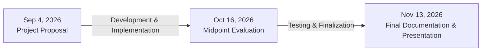
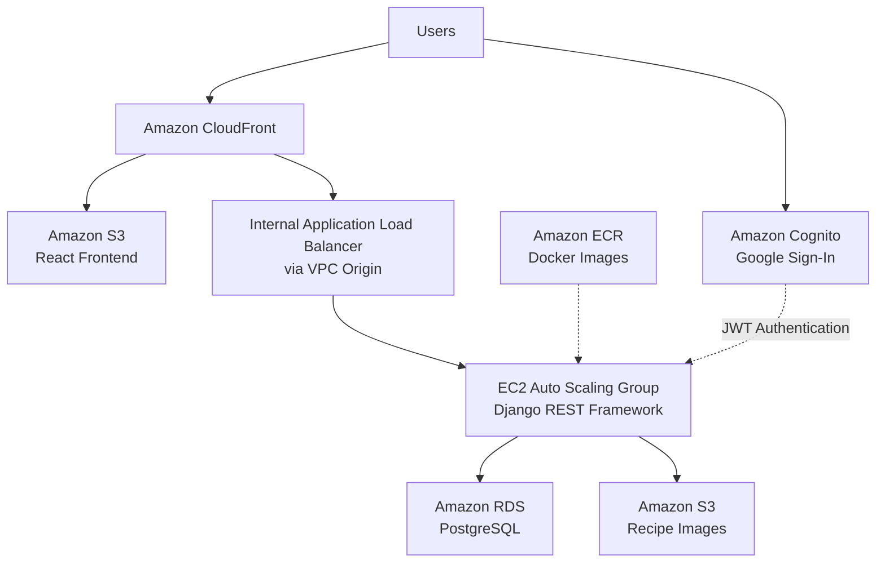

# Recipe Suggestion App

> 📄 **Final Project Documentation:** [View Full Report](docs/Final%20zdocumentation.pdf)

A cloud-based web application that helps users discover recipes based on ingredients they already have, manage personal ingredient inventories, and explore recipes according to dietary preferences and other filtering criteria.

The application was developed as part of a Cloud Computing course project and deployed on Amazon Web Services (AWS).

## Project Milestones



### Project Deliverables

- **Project Proposal — September 4, 2026:** Initial requirements, proposed features, technology stack, and architecture.
- **Midpoint Evaluation — October 16, 2026:** AWS infrastructure development, deployment progress, and working application prototype. See [Midpoint Evaluation Documentation](docs/midpoint/PROGRESS.md) and [Midpoint Demo Video](https://www.youtube.com/watch?v=-jjEv46YW-0).
- **Final Evaluation — November 13, 2026:** Completed application features, production AWS deployment, testing, documentation, and final presentation.

## Overview

The Recipe Suggestion App helps users decide what to cook based on ingredients they already have.

Users can browse recipes, search and filter available options, and manage a personal ingredient inventory. Registered users can also manage dietary preferences and allergies, receive ingredient-based recipe suggestions, save recipes, and submit their own recipes.

The application aims to simplify meal planning, encourage the use of available ingredients, and reduce unnecessary food waste.

### Target Users

The application primarily targets college students and individuals looking for convenient, affordable meal ideas without spending significant time planning meals or purchasing additional ingredients.

## Implemented Features

### Recipe Discovery and Recommendations

- Browse available recipes and view detailed cooking instructions.
- Search and filter recipes by supported criteria, including cuisine, dietary preferences, allergens, and preparation time.
- Receive recipe suggestions based on ingredients in a personal inventory.
- Discover recipes using available-ingredient and partial-match recommendation modes.

### User Accounts and Personalization

- User authentication through Amazon Cognito with Google Sign-In.
- Personalized dashboard for authenticated users.
- User profile and dietary preference management.
- Allergy management and preference-based recipe filtering.
- Personal ingredient inventory management.
- Save and access favorite recipes.
- Submit new recipes, including recipe images.

### Cloud Infrastructure

- React frontend hosted through Amazon S3 and CloudFront.
- Containerized Django REST Framework backend deployed on Amazon EC2.
- Application Load Balancer and EC2 Auto Scaling for backend availability and scalability.
- PostgreSQL database hosted on Amazon RDS.
- Private Amazon S3 storage for recipe images.
- Amazon ECR for Docker image storage.
- CloudFormation templates for AWS infrastructure provisioning.
- Private networking, security groups, and VPC endpoints for infrastructure security.

## High-Level Architecture

The application uses a cloud-based client-server architecture deployed on AWS.



CloudFront serves the frontend from a private S3 bucket and routes API requests through a VPC origin to an internal Application Load Balancer. The load balancer distributes requests across containerized Django backend instances managed by an EC2 Auto Scaling Group.

The backend communicates with Amazon RDS for persistent data storage and Amazon S3 for recipe images. Amazon Cognito provides user authentication, while Django handles application-level authorization and user data.

The production environment also uses private subnets, VPC endpoints, security groups, NAT networking, and AWS Systems Manager to support secure infrastructure operations.

For the complete infrastructure configuration, refer to the AWS architecture and deployment documentation.

## Technology Stack

| Component | Technology |
|---|---|
| Cloud Platform | Amazon Web Services (AWS) |
| Frontend | React, Vite, React Router |
| Frontend Hosting | Amazon S3, Amazon CloudFront |
| Backend | Python, Django, Django REST Framework |
| Backend Deployment | Docker, Amazon EC2 |
| Load Balancing | Application Load Balancer |
| Auto Scaling | Amazon EC2 Auto Scaling |
| Database | PostgreSQL, Amazon RDS |
| Media Storage | Amazon S3 |
| Container Registry | Amazon ECR |
| Authentication | Amazon Cognito, Google Sign-In |
| Infrastructure as Code | AWS CloudFormation |
| Networking | Amazon VPC, NAT Gateway, VPC Endpoints |
| API | REST |
| Version Control | Git, GitHub |

## Design Principles

The application follows several software engineering and cloud architecture principles:

- **Separation of Concerns:** Frontend presentation, backend business logic, database operations, and infrastructure configuration are maintained separately.
- **Modularity:** Application functionality is organized into Django applications and reusable React components.
- **Reusability:** Shared components and services reduce duplication and improve maintainability.
- **Scalability:** EC2 Auto Scaling and load balancing allow the backend to support changing workloads.
- **Security:** Private subnets, security groups, Cognito authentication, JWT validation, and managed secrets help protect application resources.
- **Infrastructure as Code:** CloudFormation templates support consistent and repeatable AWS infrastructure deployment.

## Testing and Validation

The application was validated through backend automated tests, deployment verification, and API load testing.

Testing activities included:

- Django backend unit and integration tests.
- Authentication and application functionality verification.
- API load testing using ApacheBench with different concurrency levels.
- EC2 and RDS resource utilization monitoring.
- Auto Scaling Group and Application Load Balancer health verification.

Detailed testing procedures and results are included in the final project documentation.

## Future Improvements

Potential improvements include:

- Administrative management interface for users and recipes.
- Recipe reviews and ratings.
- Shopping list generation based on missing ingredients.
- AI-powered recipe recommendations and conversational assistance.
- Additional monitoring and security features, including CloudWatch enhancements and AWS WAF.
- Multi-AZ database deployment and improved infrastructure redundancy.
- Automated CI/CD pipelines.
- Enhanced dietary and allergen filtering.

These improvements are outside the scope of the completed course implementation.

## Project Documentation

Detailed project documentation is maintained in the `docs/` directory, covering requirements, system design, database design, API design, AWS architecture, and project evaluations.

The main README provides a high-level overview of the completed application, while the supporting documentation contains implementation details, infrastructure decisions, and evaluation results.

## Repository Structure

```text
cloud_computing_proj/
├── README.md
├── docs/
├── backend/
├── frontend/
└── infrastructure/
    ├── ...
    └── scripts/
```

## Project Documentation

Detailed technical documentation is maintained in the `docs/` directory:

- [Requirements](docs/requirements.md) — Functional and non-functional requirements.
- [System Design](docs/system-design.md) — Application architecture, components, and design decisions.
- [Database Design](docs/database-design.md) — Database models and relationships.
- [API Design](docs/api-design.md) — REST API endpoints, request and response formats.
- [AWS Architecture](docs/aws-architecture.md) — Cloud infrastructure, networking, security, and deployment.

For implementation-specific information, refer to the [Frontend README](frontend/README.md) and [Backend README](backend/README.md).