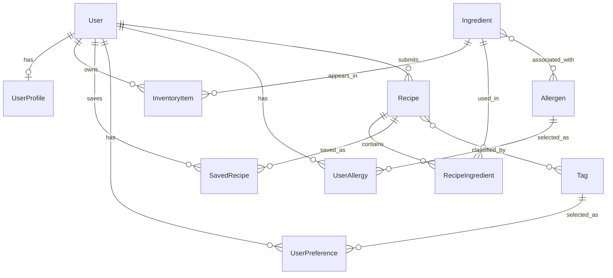

# Database Design — Recipe Suggestion App

## 1. Overview

The Recipe Suggestion App uses **PostgreSQL hosted on Amazon RDS** as its production relational database.

The database stores application-specific information, including users, recipes, ingredients, inventories, dietary preferences, allergies, and saved recipes.

During local development, SQLite was used for development and testing before migrating the production database to PostgreSQL.

The database is managed through Django's Object-Relational Mapping (ORM) and migration system.

### Design Principles

- **Data Normalization:** Shared information is represented through reusable entities and relationships.
- **Referential Integrity:** Foreign keys maintain relationships between application data.
- **Separation of Concerns:** Authentication is managed by Amazon Cognito, while PostgreSQL stores application-specific information.
- **Data Persistence:** Registered-user data is stored persistently, while temporary guest selections do not require database records.
- **External Media Storage:** Recipe images are stored in Amazon S3 rather than directly in PostgreSQL.

## 2. Core Database Entities

The application organizes its data into five Django modules.

| Django Module | Main Entities | Purpose |
|---|---|---|
| Users | `User`, `UserProfile`, `UserPreference`, `UserAllergy` | User identity mapping, profiles, preferences, and allergies |
| Ingredients | `Ingredient`, `Tag`, `Allergen` | Shared ingredient records and classifications |
| Recipes | `Recipe`, `RecipeIngredient`, `SavedRecipe` | Recipe information, ingredients, ownership, and saved recipes |
| Inventory | `InventoryItem` | User-owned ingredient inventory |
| Recommendations | No dedicated persistent recommendation entity | Dynamic recipe matching based on available ingredients |

These entities represent the main application concepts. Detailed field definitions and constraints are maintained in Django models and migrations.

## 3. Entity Relationships

The database uses foreign keys and many-to-many relationships to connect users, ingredients, recipes, and preferences.

### High-Level Relationship Diagram

### Relationship Summary

| Relationship | Type | Description |
|---|---|---|
| User – UserProfile | One-to-one | Application-specific profile information |
| User – InventoryItem | One-to-many | Personal ingredient inventory |
| Ingredient – RecipeIngredient | One-to-many | Ingredients reused across recipes |
| Recipe – RecipeIngredient | One-to-many | Ingredients required by a recipe |
| User – SavedRecipe – Recipe | Many-to-many | Users save recipes |
| User – UserPreference – Tag | Many-to-many | Users save dietary and cuisine preferences |
| User – UserAllergy – Allergen | Many-to-many | Users save allergy information |
| Recipe – Tag | Many-to-many | Recipes have standardized classifications |
| Ingredient – Allergen | Many-to-many | Ingredients may contain recognized allergens |

## 4. User Data and Authentication

Amazon Cognito manages authentication, including Google Sign-In.

The Django backend validates Cognito access tokens and associates authenticated identities with application users.

Each Cognito identity is mapped to a local user using its issuer and subject (`sub`).

The application database stores user-related information such as:

- User profiles and display names.
- Saved ingredients and inventories.
- Dietary preferences.
- Allergy selections.
- Saved recipes.
- Submitted recipe ownership.

Authentication credentials are managed by Cognito rather than by the application's PostgreSQL user records.

## 5. Recipes and Ingredients

### Ingredient

`Ingredient` represents a reusable food ingredient shared across recipes, inventories, and recommendation processing.

Using canonical ingredient records avoids unnecessary duplication and allows different application features to reference the same ingredient.

### Recipe

`Recipe` stores the primary recipe information, including its name, description, preparation instructions, cooking-related information, and image reference.

Recipes imported from TheMealDB and recipes submitted by registered users are stored in the application database.

User-submitted recipes are associated with their authenticated owners.

### RecipeIngredient

`RecipeIngredient` connects a recipe to its ingredients.

This relationship can store recipe-specific information such as quantity, unit, optional status, and preparation notes.

It also provides the ingredient relationships used by the recommendation system.

### SavedRecipe

`SavedRecipe` associates an authenticated user with a recipe they have saved.

This allows registered users to maintain a personal saved-recipe collection without duplicating the original recipe record.

## 6. Inventory, Preferences, and Allergies

### InventoryItem

`InventoryItem` represents an ingredient saved in a registered user's personal inventory.

Each inventory item connects a user to a canonical ingredient.

The recommendation system can use saved inventory data to identify recipes that match available ingredients.

### Tag and UserPreference

`Tag` provides standardized recipe classifications, including:

- `DIET`
- `CUISINE`
- `COST`
- `OTHER`

Recipes are associated with tags for filtering and classification.

`UserPreference` connects registered users to their saved tags, allowing preferences to be reused during recipe browsing.

### Allergen and UserAllergy

`Allergen` represents a recognized food allergen.

Ingredients can be associated with allergens, and registered users can save allergy information through `UserAllergy`.

These relationships support allergen-based recipe filtering.

## 7. Recommendation Data

The recommendation system calculates recipe matches dynamically rather than storing a separate persistent recommendation record for each request.

It uses existing database relationships involving:

- Ingredients and recipe ingredients.
- Saved user inventories.
- Recipe tags and user preferences.
- Ingredient allergens and user allergies.

The system supports two recommendation modes:

| Mode | Description |
|---|---|
| `AVAILABLE_ONLY` | Matches recipes whose required ingredients are available |
| `PARTIAL_MATCH` | Finds recipes with partially matching ingredients and identifies missing ingredients |

Temporary guest ingredient selections and recommendation results do not require persistent user database records.

## 8. Data Integrity and Storage

### Referential Integrity

Django models use relational fields and database constraints to maintain consistency between application entities.

Important uniqueness rules include preventing duplicate saved-recipe relationships and duplicate ingredient entries within the same user's inventory.

Shared entities such as ingredients, tags, and allergens are reused rather than duplicated unnecessarily.

### Media Storage

Recipe images are stored in a private Amazon S3 bucket using Django's storage integration.

PostgreSQL stores recipe metadata and media references, while the actual image files remain in S3.

### Production Database

The production PostgreSQL database runs on Amazon RDS within the application's private AWS networking environment.

Backend EC2 instances access the database through controlled security-group rules.

Database credentials are provided securely through AWS Secrets Manager.

The production database was initially populated with **100 recipes and associated images** imported from TheMealDB.

## 9. Future Improvements

The following database features remain potential future development:

- Recipe reviews and ratings.
- Shopping lists and shopping-list items.
- Expanded inventory quantities and expiration tracking.
- Recommendation history and analytics.
- Additional administrative management functionality.

These features were included in the original project requirements but are not part of the final implemented database design.

## 10. Related Documentation

- [Requirements](requirements.md) — Original project requirements.
- [System Design](system-design.md) — Application architecture and components.
- [API Design](api-design.md) — REST API endpoints and data access.
- [AWS Architecture](aws-architecture.md) — Production database hosting, storage, and networking.
- [Main README](../README.md) — Project overview.