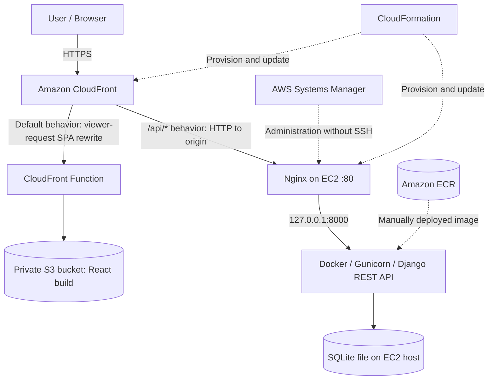
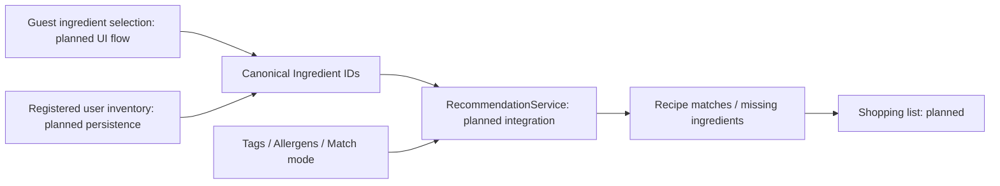
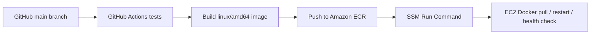

# Recipe Suggestion App — Midpoint Evaluation Report

**Course:** Cloud Computing  
**Evaluation date:** October 16, 2026  
**Final project deadline:** November 13, 2026  
**Repository:** https://github.com/sophia-dao/cloud_computing_proj  
**Group members:** Sophia Dao, Burhan Khokhar, Brooke Sayer, Huy Le  
**Report updated:** October 15, 2026

> **Status convention:** **Implemented** means code or infrastructure exists; **Verified** means a specific observed check passed; **Planned** means not yet implemented or verified. A working cloud deployment does not imply all application features are complete.

## 1. Project overview

The Recipe Suggestion App aims to reduce household food waste by helping users find recipes based on ingredients they already have. Users will provide available ingredients and receive suggestions that can account for dietary preferences, allergies, and cuisine choices.

The planned roles are **Guest**, **Registered User**, and **Administrator**. Guests can select temporary ingredients and explore suggestions. Registered users will also manage persistent inventory, saved recipes, shopping lists, and profile preferences. Administrators will have management capabilities. The planned recommendation modes are **AVAILABLE_ONLY** (all required ingredients are available) and **PARTIAL_MATCH** (some additional ingredients are needed).

At midpoint, the project has working frontend hosting, a deployed Django API, tested foundational application code, and infrastructure provisioned through CloudFormation. The full recipe recommendation experience and authenticated user workflows are not yet complete.

## 2. Architecture and changes from the original plan

### 2.1 Original architecture and service choices

The original design, described in `README.md`, `docs/system-design.md`, and `docs/aws-architecture.md`, uses a **client-server architecture with a modular-monolith Django backend**, rather than microservices. The planned stack includes React, Django REST Framework, EC2, Docker, ECR, S3/CloudFront, RDS PostgreSQL, Cognito, and AWS security/monitoring services.

| Component | Original design | Midpoint status |
|---|---|---|
| React frontend | Static build on S3, delivered through CloudFront | **Deployed; HTTPS delivery verified** |
| Django backend | Dockerized REST API on one EC2 instance | **Deployed; public API requests verified through CloudFront** |
| Container registry | Amazon ECR | **Deployed; backend image pushed** |
| Relational database | PostgreSQL on Amazon RDS | **Planned; deployed backend currently uses persistent-on-host SQLite** |
| Authentication | Amazon Cognito; Django handles authorization | **Planned; not yet integrated or verified** |
| Application media | Amazon S3 | **Planned; separate application-media integration not verified** |
| Secrets and monitoring | Secrets Manager and CloudWatch | **Planned for fuller integration and monitoring** |
| Networking | VPC, subnets, routing, security groups | **Deployed and configured** |
| CI/CD | GitHub Actions with AWS authentication | **OIDC provider configured; automated rollout not implemented** |

The original design intentionally started with one backend instance. Application Load Balancing, Auto Scaling, and multi-instance availability remain potential future improvements rather than completed capabilities.

### 2.2 Architectural rationale and trade-offs

- **Modular monolith:** Django modules separate Users, Ingredients, Recipes, Inventory, Recommendations, Reviews, and Shopping while sharing one application deployment and a canonical `Ingredient` model. This reduces operational complexity but means backend modules initially scale together.
- **EC2 with Docker and ECR:** EC2 provides control over host networking and application deployment; Docker makes the runtime reproducible; ECR stores deployable images. The team must manage instance health, configuration, and releases.
- **S3 and CloudFront:** Static React assets are served separately from Django, while CloudFront offers one HTTPS entry point for frontend and API paths. Origin routing and SPA error behavior require explicit configuration.
- **RDS PostgreSQL:** The intended durable relational database is separate from disposable application containers. It is deferred to a later phase; SQLite is a temporary midpoint choice.
- **Cognito with Django authorization:** Cognito is intended to handle sign-in and identity, while Django will enforce resource ownership and role permissions. This integration is not yet verified.
- **Deferred high availability:** Two subnets exist in separate Availability Zones, but only one EC2 backend instance runs. The system does not currently provide automatic instance failover or horizontal scaling.

### 2.3 Implementation refinements introduced by midpoint

| Area | Refinement | Reason and trade-off |
|---|---|---|
| Infrastructure provisioning | CloudFormation stacks for network, ECR, backend, frontend, and GitHub OIDC | Version-controlled, reviewable changes; added template/debugging effort |
| Availability Zones | Second public subnet in another AZ | Resolved initial instance-type availability issue; does not itself create high availability |
| EC2 administration | Systems Manager Session Manager | Verified access without inbound SSH |
| Application serving | Gunicorn in Docker; Nginx on EC2 | Runs Django behind a reverse proxy; requires correct host and proxy configuration |
| Public application entry | CloudFront routes frontend requests to S3 and `/api/*` to EC2 | One public HTTPS domain; origin HTTP remains a security limitation |
| SPA routing | CloudFront Function rewrites extensionless frontend paths to `/index.html` | Preserves React client-side navigation without masking backend 403/404 errors |
| Database rollout | SQLite file persisted on EC2 host | Supports midpoint API deployment; lacks managed database availability and scaling |
| Deployment automation | OIDC infrastructure prepared; manual deployment still used | Prioritized verified deployment before CI/CD workflow completion |

### 2.4 Current deployed architecture



*Figure 1. Midpoint deployed request path. Solid arrows show the deployed request flow; dashed arrows indicate provisioning, administration, or image-delivery relationships. CloudFront-to-EC2 uses HTTP, not HTTPS.*

**Deployed infrastructure details:**

| Resource | Identifier / configuration |
|---|---|
| Region | `us-east-1` |
| Frontend CloudFormation stack | `recipe-app-frontend` |
| CloudFront distribution | `E2YMECNRA0V5YR` |
| Public application URL | `https://d1q0iv2raorz8j.cloudfront.net` |
| Private frontend bucket | `recipe-app-frontend-frontendbucket-yhbrd6afosjk` |
| Backend instance | `i-0f80e33afb9d7dd0a` (`t3.micro`) |
| Backend Elastic IP | `3.214.51.24` |
| Backend origin DNS | `ec2-3-214-51-24.compute-1.amazonaws.com` |
| Backend ECR image | `recipe-app-backend:midpoint-v1` |
| CloudFront API path behavior | `/api/*` to EC2/Nginx |
| CloudFront SPA behavior | Viewer-request function on default S3 behavior |

The VPC has two public subnets in separate Availability Zones. The current backend uses one EC2 instance, and the container exposes Gunicorn only through `127.0.0.1:8000`. Nginx receives origin requests on port 80 and proxies them to Django.

### 2.5 Application architecture and intended recommendation flow

The backend uses domain-oriented Django modules and a shared canonical `Ingredient` model. Guest ingredient selections and registered-user inventory are intended to feed the same `RecommendationService`, with preference/allergen filtering and the two recommendation modes.



*Figure 2. Intended recommendation data flow. The canonical Ingredient API foundation is implemented; this diagram does not claim that the full recommendation workflow is operational.*

### 2.6 Planned automated deployment workflow



*Figure 3. Proposed CI/CD workflow, not yet operational. The GitHub OIDC identity provider is configured, but an end-to-end GitHub Actions deployment has not been verified.*

## 3. Implementation progress

### 3.1 Application code

Five GitHub issues were reported completed under the **MVP / Midpoint Evaluation** milestone. These establish the application's foundations, not the complete feature set.

| Component | Status | Evidence / limitation |
|---|---|---|
| Django REST backend foundation | Implemented and locally tested | Project structure and REST API configured |
| Canonical Ingredient API — Issue #1 | Completed and tested | Model, case-insensitive search, detail lookup, HTTP 404/405 behavior, automated tests |
| User Profile & Preferences — Issue #2 | Completed locally; Cognito pending | Local profile/preference checks passed; cloud authentication not verified |
| React Application Foundation — Issue #3 | Completed | React routing, layouts, shared API client foundation |
| Dockerized Django Backend — Issue #15 | Completed; local and cloud runtime verified | Gunicorn image tested locally; Dockerized Django now responds through deployed CloudFront API path |
| Reusable UI Design System — Issue #34 | Completed | Shared components, layout templates, and styling |
| Recipes, inventory, recommendations, saved recipes | Pending / in development | Feature completion and integration still required |
| Frontend-to-backend connectivity | **Cloud routing verified; user workflow pending** | Public CloudFront domain reaches Django API; no claim of complete browser-based recipe workflow |

The shared canonical `Ingredient` model is a key dependency for inventory, recipes, and recommendations. The frontend foundation provides reusable structures for subsequent team implementation.

### 3.2 AWS infrastructure and deployment

| Resource / practice | Current status | Verification performed |
|---|---|---|
| VPC, Internet Gateway, route table, two public subnets | Deployed | CloudFormation network stack completed and updated |
| EC2 backend (`t3.micro`) | Deployed | Backend stack and instance verified |
| Docker on EC2 | Verified | Docker service/version checked through SSM; backend container serving requests |
| AWS Systems Manager | Verified | Interactive session established without inbound SSH |
| Amazon ECR | Deployed | `recipe-app-backend:midpoint-v1` image pushed |
| Dockerized Django / Gunicorn on EC2 | **Deployed and verified** | Public `/api/ingredients/` returns HTTP 200 through CloudFront → Nginx → Django |
| Nginx reverse proxy | **Configured and verified** | Django responses delivered through EC2 origin |
| GitHub OIDC identity provider | Configured | Provider created; GitHub Actions rollout not verified |
| Private S3 frontend bucket | Deployed | React build uploaded |
| CloudFront / Origin Access Control | **Deployed and verified** | HTTPS frontend delivery from private S3 origin |
| React production build | Verified | Vite build previously compiled 93 modules |
| CloudFront `/api/*` behavior | **Deployed and verified** | Django API responds through the same public domain |
| CloudFront SPA rewrite function | **Deployed and verified** | `/dashboard` returns HTML with HTTP 200 |
| API error preservation | **Verified** | Missing ingredient returns HTTP 404 and JSON rather than React HTML |
| Missing asset error handling | **Verified** | Nonexistent JavaScript asset returns HTTP 403/404 rather than 200 |
| Automated frontend/backend deployment | Pending | GitHub Actions workflows not yet implemented and tested |
| RDS PostgreSQL | Pending | Current deployed API uses SQLite |
| Cognito authentication | Pending | No verified protected cloud API flow |

#### Public deployment and request routing

The React build is stored in a private S3 bucket and served over HTTPS through CloudFront. CloudFront's default cache behavior serves the frontend; `/api/*` routes to the EC2 custom origin. The backend image runs Django with Gunicorn in Docker, and Nginx forwards requests from port 80 to the container's loopback port 8000.

The backend API behavior uses the AWS-managed **CachingDisabled** policy (`4135ea2d-6df8-44a3-9df3-4b5a84be39ad`) and **AllViewerExceptHostHeader** origin request policy (`b689b0a8-53d0-40ab-baf2-68738e2966ac`). This avoids CloudFront response caching for the API and forwards request information with the EC2 origin hostname as the `Host` header.

To support React client-side routes, a CloudFront Function rewrites extensionless frontend paths to `/index.html` on the default behavior. Distribution-wide 403/404-to-200 error mappings were removed because they incorrectly replaced Django API errors with frontend HTML.

### 3.3 Deployment evidence and remaining integration boundary

The verified public endpoint is:

`https://d1q0iv2raorz8j.cloudfront.net/api/ingredients/`

The deployed API currently returns an empty paginated list because its database does not yet contain ingredient records. This confirms network routing and backend execution; it does **not** verify a complete ingredient-selection-to-recipe-recommendation journey inside React.

## 4. Testing and evidence

| Test | Observed result | Status |
|---|---|---|
| Local Ingredient API | Case-insensitive search; missing ID 404; unsupported POST 405 | Passed |
| Local Django tests | Ingredient tests and user/profile checks passed; latest total not recorded in this report | Passed (count to refresh) |
| Local Docker smoke test | HTTP 200 after database migrations | Passed |
| AWS provisioning | Network, ECR, EC2, frontend CloudFormation resources deployed | Passed |
| Container image distribution | `linux/amd64` backend image pushed to ECR | Passed |
| Public frontend | CloudFront returns HTTP 200 and HTML from S3 | Passed |
| Public ingredients API | CloudFront `/api/ingredients/?format=json` returns HTTP 200 and JSON | Passed |
| Missing ingredient | `/api/ingredients/999999/` returns HTTP 404 and JSON error | Passed |
| React client-side route | `/dashboard` returns HTTP 200 with HTML | Passed |
| Missing static asset | `/assets/nonexistent.js` returns HTTP 403/404, not 200 | Passed |
| Full React recommendation workflow | Not yet demonstrated | Pending |
| Cognito protected API flow | Not yet demonstrated | Pending |
| Load/scalability benchmark | Not yet performed | Pending |

Representative commands used for public verification:

```bash
curl -i 'https://d1q0iv2raorz8j.cloudfront.net/api/ingredients/?format=json'
curl -i 'https://d1q0iv2raorz8j.cloudfront.net/api/ingredients/999999/'
curl -I 'https://d1q0iv2raorz8j.cloudfront.net/dashboard'
curl -I 'https://d1q0iv2raorz8j.cloudfront.net/assets/nonexistent.js'
```

The missing-ingredient test returned:

```http
HTTP/1.1 404 Not Found
Content-Type: application/json
```

```json
{"detail":"No Ingredient matches the given query."}
```

The successful ingredient list returned the expected pagination structure (`count`, `next`, `previous`, `results`), with an empty `results` array. These are endpoint smoke tests, not load tests or complete user-journey tests.

## 5. Challenges and lessons learned

| Challenge | Cause | Resolution / lesson |
|---|---|---|
| EC2 instance-type unavailable in initial AZ | Capacity/availability limitation in selected subnet's AZ | Added a second public subnet in another AZ and deployed there; subnet diversity is not automatic failover |
| Docker API errors before migration | New SQLite database lacked Django schema | Applied migrations; database initialization must be included in deployment procedure |
| Invalid CloudFront cache policy | Incorrect managed policy ID in template | Replaced with verified `Managed-CachingDisabled` ID; CloudFormation syntax validation does not validate every external service identifier |
| CloudFormation parameter reuse failure | `BackendOriginKey` was introduced in a failed, rolled-back update | Supplied the private value again through a protected temporary parameter file; `UsePreviousValue` works only after successful deployment of the parameter |
| Django HTTP 400 behind CloudFront | EC2 origin hostname absent from `DJANGO_ALLOWED_HOSTS` | Added origin DNS to allowed hosts and recreated the container to reload environment variables |
| API 404 incorrectly returned HTTP 200 with React HTML | Distribution-wide CloudFront custom error responses converted 403/404 into SPA fallback | Removed those mappings; added viewer-request CloudFront Function for frontend routes only |
| zsh rejected an API test URL | Unquoted `?` interpreted as a shell wildcard | Quoted URL in `curl` command; error occurred locally, not in AWS |
| Risk of replacing running resources | Infrastructure changes can trigger resource replacement | Inspected CloudFormation change sets; verified distribution modification with `Replacement: False` |

These issues reinforced the distinction between successful provisioning, healthy runtime behavior, and correct application-level HTTP responses. The team tested both valid and invalid endpoints rather than relying solely on HTTP 200 checks.

## 6. Security and scalability

### 6.1 Implemented security practices

- **HTTPS for users:** Browser-to-CloudFront traffic uses HTTPS; the API cache behavior redirects HTTP viewers to HTTPS.
- **Private frontend storage:** S3 public access is blocked, and CloudFront uses Origin Access Control with a distribution-restricted bucket policy.
- **Restricted backend ingress:** EC2 inbound port 80 is restricted to the AWS-managed CloudFront origin-facing prefix list (`pl-3b927c52`), rather than open to all internet addresses. No inbound SSH is required.
- **Additional origin check:** CloudFront sends a private `X-Recipe-Origin-Key` header that Nginx validates before forwarding `/api/` requests. The value is not stored in the repository.
- **Container isolation:** Django is published only on EC2 loopback (`127.0.0.1:8000`); Nginx handles incoming origin traffic.
- **IAM and administration:** EC2 uses IAM roles; Systems Manager Session Manager provides access without SSH; GitHub OIDC infrastructure is configured for future short-lived credentials.
- **Additional infrastructure controls:** ECR immutable tags and image scanning, encrypted EC2 root EBS volume, and IMDSv2 requirement were configured during infrastructure setup.

### 6.2 Security limitations

**CloudFront-to-EC2 currently uses HTTP on port 80.** Thus, even though clients connect to CloudFront over HTTPS, the origin connection is not encrypted. The private header is only an additional access check; it is not equivalent to TLS or application authentication. The managed CloudFront prefix list also covers CloudFront origin-facing infrastructure generally, not this distribution exclusively.

Until origin HTTPS and Cognito/Django authorization are implemented and verified, the deployed API should be used only with nonsensitive demonstration data. The report does not claim secure handling of user credentials or private account data.

### 6.3 Scalability and availability

The present deployment has one `t3.micro` EC2 instance running Django and a SQLite database file on the host. This is appropriate for an initial demonstration but is **not** highly available and does not automatically scale backend compute. The second subnet provides placement flexibility, not a running redundant backend.

CloudFront can distribute and cache static frontend assets, but this does not demonstrate scalable Django throughput. Before the final evaluation, the team should perform repeatable load tests and report requests per second, response-time percentiles, error rates, and CPU/memory utilization. Depending on measured constraints, improvements could include PostgreSQL on RDS, health checks, monitoring, an Application Load Balancer, and EC2 Auto Scaling across Availability Zones. **No load-test statistics or automatic-scaling behavior are claimed at midpoint.**

## 7. Remaining work and risks

| Remaining task | Main risk | Next action |
|---|---|---|
| Complete recipe, inventory, and recommendation features | Missing core MVP functionality | Prioritize one available-ingredients-to-recipe result journey |
| Verify frontend user journey | Public API route works, but feature-level UI integration is incomplete | Connect React ingredient selection and recommendation views to live API responses |
| Integrate Cognito and protected endpoints | Identity mapping and authorization complexity | Implement and test sign-in, ownership, and role restrictions **after securing origin traffic** |
| Improve origin security | CloudFront-to-EC2 traffic currently uses HTTP | Configure valid origin TLS and HTTPS-only CloudFront origin policy |
| Introduce managed persistent database | SQLite limits concurrency and durability | Migrate to RDS PostgreSQL or document and test a justified interim persistence strategy |
| Implement GitHub Actions CI/CD | Manual deployments and rollout errors | Verify OIDC permissions and automate test, build, push, rollout, and health checks |
| Complete media and monitoring integrations | Missing operational features | Implement necessary S3 media support and CloudWatch monitoring |
| Measure scalability | No numerical evidence for course requirement | Run repeatable load tests; capture throughput, latency, errors, and resource use |
| Final demo and documentation | Schedule and integration risk | Freeze scope, capture screenshots, and verify a repeatable end-to-end demo |

## 8. Plan through final submission

**Midpoint — October 16:** Demonstrate the deployed CloudFront frontend, working Django API through the same HTTPS domain, foundational local application tests, Docker/ECR workflow, CloudFormation infrastructure, and documented error-handling fixes. Clearly label incomplete application workflows and security limitations.

**Next phase:** Complete a minimal end-to-end recipe recommendation journey; integrate frontend features with backend APIs; secure the backend origin; implement authentication and persistence as feasible; verify application data flows.

**Finalization — by November 13:** Finish prioritized functionality, automate deployment, add monitoring, run security and scalability checks, collect measurable results, perform regression tests, update diagrams, and record the final demonstration.

## 9. Midpoint conclusion

The project has progressed from an initial proposal to a structured React/Django codebase with five reported completed MVP issues covering ingredient management, user profiles, frontend structure, reusable UI design, and containerization. The team has also deployed AWS networking, EC2 compute, Dockerized Django, ECR, a private S3 frontend, and a CloudFront distribution using CloudFormation.

**The principal infrastructure milestone is now verified:** requests to the public CloudFront HTTPS domain reach the Django REST API through Nginx on EC2. Successful requests return JSON, nonexistent ingredients return proper HTTP 404 JSON errors, React routes return frontend HTML, and missing static assets retain error responses. These checks demonstrate a working deployed request path rather than only provisioned resources.

The application is **not yet feature-complete or production-ready**. Recipe recommendation workflows, Cognito integration, origin HTTPS, managed persistence, automated deployment, and measured scalability remain priorities for the November 13 final submission.

---

### Final review checklist — remove before submission

- [ ] Confirm which teammate features have been merged into `main` and update the application feature table if necessary.
- [ ] Run the latest Django tests and record the exact test count and command output.
- [ ] Capture screenshots of CloudFront frontend, successful API JSON, API 404 JSON, and relevant CloudFormation resources.
- [ ] Confirm deployed URLs and the current AWS infrastructure diagram match the demo environment.
- [ ] Rehearse one repeatable live demonstration and ensure no unverified functionality is presented as complete.
