# Recipe Suggestion App — Midpoint Evaluation Report

**Course:** Cloud Computing  

**Evaluation date:** October 16, 2026  

**Final project deadline:** November 13, 2026  

**Repository:** https://github.com/sophia-dao/cloud_computing_proj  

**Demo video link:** https://www.youtube.com/watch?v=-jjEv46YW-0

**Group members:** Sophia Dao, Burhan Khokhar, Brooke Sayer, Huy Le  

**Report updated:** October 15, 2026

> **Status convention:** **Implemented** means code or infrastructure exists; **Verified** means a specific observed check passed; **Planned** means not yet implemented or verified. A working cloud deployment does not imply all application features are complete.

## 1. Project overview

The Recipe Suggestion App aims to reduce household food waste by helping users find recipes based on ingredients they already have. Users will provide available ingredients and receive suggestions that can account for dietary preferences, allergies, and cuisine choices.

At midpoint, the project has working frontend hosting, a deployed Django API, tested foundational application code, and infrastructure provisioned through CloudFormation. The full recipe recommendation experience and authenticated user workflows are not yet complete.

## 2. Architecture and changes from the original plan

### 2.1 Original architecture and service choices

The original plan, which was documented in [`README.md`](README.md), [`aws-architecture.md`](docs/aws-architecture.md) and [`system-design.md`](docs/system-design.md), uses a **client-server architecture with a modular-monolith Django backend**, rather than microservices. The planned stack includes React, Django REST Framework, EC2, Docker, ECR, S3/CloudFront, RDS PostgreSQL, Cognito, and AWS security/monitoring services.

| Component | Original design | Midpoint status |
|---|---|---|
| React frontend | Static build on S3, delivered through CloudFront | **Deployed; HTTPS delivery verified** |
| Django backend | Dockerized REST API on one EC2 instance | **Deployed; public API requests verified through CloudFront** |
| Container registry | Amazon ECR | **Deployed; backend image pushed** |
| Relational database | PostgreSQL on Amazon RDS | **Planned; deployed backend currently uses persistent-on-host SQLite** |
| Authentication | Amazon Cognito; Django handles authorization | **Planned; not yet integrated or verified** |
| Application media | Amazon S3 | **Planned; separate application-media integration not verified** |
| Secrets and monitoring | Secrets Manager and CloudWatch | **Planned for fuller integration and monitoring** |
| Networking | VPC, subnets, routing, security groups | **Deployed and configured** |
| CI/CD | GitHub Actions with AWS authentication | **Planned; automated tests and deployment not yet implemented** |

The original design intentionally started with one backend instance. Application Load Balancing, Auto Scaling, and multi-instance availability remain potential future improvements rather than completed capabilities.

### 2.2 Architectural Rationale

The Recipe Suggestion App uses a modular backend architecture with containerized deployment and separate frontend hosting. The design prioritizes maintainability, team collaboration, reproducible deployments, and manageable AWS infrastructure costs during development.

#### 2.2.1 Modular Monolith — Django Backend

The Django backend is organized into separate functional apps, including Users, Ingredients, Recipes, Inventory, and Recommendations. This allows team members to develop most features independently and in parallel while sharing a single backend deployment.

**Key benefits:**
- Clear separation of application responsibilities.
- Easier collaboration, testing, and maintenance.
- Shared data models and interfaces across related apps.
- Lower deployment and operational complexity compared with microservices.

#### 2.2.2 Containerized Backend — EC2, Docker, and ECR

The Django backend runs inside a Docker container hosted on Amazon EC2. Docker packages the application and its dependencies into a consistent runtime environment, while Amazon Elastic Container Registry (ECR) stores versioned container images.

**Deployment workflow:**

1. Build a Docker image from the Django backend source code.
2. Push the image to Amazon ECR.
3. Pull the image from ECR onto the EC2 instance.
4. Run the image as a Docker container to serve backend API requests.
5. For application updates, build and deploy a new image to replace the previous container.

This approach simplifies backend releases and provides control over the application environment. The team remains responsible for EC2 configuration, instance health, security, and deployment management.

#### 2.2.3 Frontend Hosting and Request Routing — S3 and CloudFront

The React frontend is compiled into static production files (HTML, CSS, and JavaScript) and hosted in a private Amazon S3 bucket. Amazon CloudFront securely accesses these files through Origin Access Control (OAC) and serves as the application's public HTTPS entry point.

**Request routing:**

- **Frontend requests:** CloudFront retrieves and caches static React assets from S3.
- **API requests (`/api/*`):** CloudFront forwards requests to the Django backend on EC2.
- **Client-side navigation:** SPA fallback configuration allows React routes to load correctly when accessed directly or refreshed.

This architecture separates static frontend hosting from backend processing, improves content delivery through caching, and provides a unified application entry point.

**Current Security Consideration — HTTPS Between CloudFront and EC2**

Currently, CloudFront provides HTTPS encryption for communication between users' browsers and the application. However, requests forwarded from CloudFront to the EC2 backend use HTTP.

This configuration was chosen to simplify the initial deployment and avoid the additional domain, TLS certificate, and reverse proxy configuration required for HTTPS on the backend. It allows the team to prioritize establishing and testing the complete frontend-to-backend communication workflow during the midpoint phase.

**Planned improvement:** The backend will be configured with a valid TLS certificate and an HTTPS endpoint, potentially using an Application Load Balancer (ALB) with AWS Certificate Manager (ACM). CloudFront will then be configured to communicate with the backend origin over HTTPS, providing encryption across both connections.

This improvement will protect API traffic in transit between CloudFront and the backend, including authentication tokens and user data.

#### 2.2.4 Planned Improvements

The following components are planned for later development phases and are not part of the current midpoint implementation.

| Component | Planned Purpose |
|---|---|
| **Amazon RDS PostgreSQL** | Replace temporary SQLite storage with a managed relational database for persistent application data, backups, and improved reliability. |
| **Amazon Cognito** | Provide user registration, sign-in, and token-based authentication, while Django enforces application-level permissions and resource ownership. |
| **High Availability and Auto Scaling** | Introduce an Application Load Balancer and EC2 Auto Scaling across multiple Availability Zones to improve fault tolerance and handle increasing traffic. |

The current deployment uses a single EC2 backend instance, prioritizing a functional and manageable infrastructure before introducing additional scaling and availability mechanisms.

### 2.3 Implementation Refinements Introduced by Midpoint

During the midpoint phase, several implementation decisions were introduced to improve deployment consistency, security, maintainability, and application accessibility. These refinements support the architecture described in Section 2.2 while keeping the infrastructure manageable for the current development stage.

| Area | Implementation Refinement | Rationale and Trade-off |
|---|---|---|
| **Infrastructure as Code** | Separate AWS CloudFormation stacks for networking, ECR, backend, and frontend resources. | Enables repeatable, version-controlled infrastructure deployments and easier resource management. However, changes require template validation and troubleshooting. |
| **Network Configuration** | VPC with public subnets, an Internet Gateway, and route tables controlling network traffic. | Provides network connectivity for the current EC2 deployment while supporting future infrastructure expansion. High availability is not yet implemented. |
| **Secure EC2 Administration** | AWS Systems Manager Session Manager for remote instance access. | Allows administrators to manage EC2 without opening inbound SSH port 22, reducing unnecessary network exposure. Requires appropriate IAM permissions and Systems Manager connectivity. |
| **Backend Application Serving** | Gunicorn runs Django inside Docker, with Nginx on EC2 acting as a reverse proxy. | Separates HTTP request handling from Django application execution and supports a production-oriented serving configuration. Requires proper proxy, host, and security settings. |
| **Unified Application Entry Point** | CloudFront routes frontend requests to S3 and `/api/*` requests to EC2. | Provides a single public HTTPS domain and separates static content delivery from backend processing. The CloudFront-to-EC2 connection currently uses HTTP, with HTTPS planned for a later phase. |
| **React Client-Side Routing** | A CloudFront Function rewrites extensionless frontend navigation paths to `/index.html`, excluding API routes. | Allows direct navigation and page refreshes in the React SPA without incorrectly converting backend API errors into frontend pages. |
| **Temporary Database Persistence** | SQLite database stored persistently on the EC2 host outside the replaceable Docker container. | Preserves application data across container replacements and simplifies midpoint deployment. However, SQLite lacks the managed availability, backup, and scaling capabilities planned with Amazon RDS PostgreSQL. |
| **Deployment Process** | Backend and frontend builds and deployments are currently performed manually. | Provides direct control and simplifies troubleshooting during initial infrastructure setup. Automated testing and deployment through GitHub Actions are planned for the final phase. |

These refinements establish a functional deployment foundation while identifying clear opportunities for improving security, automation, and scalability in the final implementation.

### 2.4 Current Deployed Architecture

The midpoint deployment consists of a React frontend hosted on Amazon S3 and delivered through CloudFront, with a containerized Django backend running on a single EC2 instance. CloudFront serves as the public application entry point and routes requests to the appropriate origin.

#### 2.4.1 Deployed Architecture Diagram

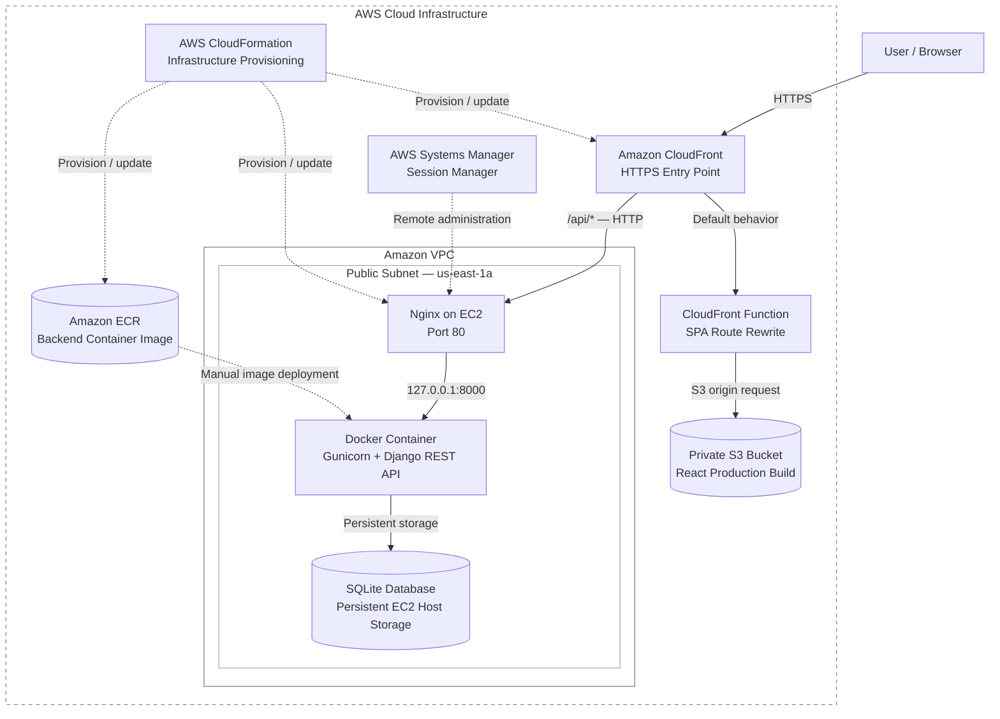

**Figure 1. Midpoint Deployed Architecture.** Solid arrows represent application request and data flows, while dashed arrows represent deployment, administration, and infrastructure management relationships. HTTPS is used between the browser and CloudFront; the current CloudFront-to-EC2 origin connection uses HTTP.

#### 2.4.2 Deployed AWS Resources

| Resource | Identifier / Configuration |
|---|---|
| **AWS Region** | `us-east-1` (N. Virginia) |
| Frontend CloudFormation Stack | `recipe-app-frontend` |
| CloudFront Distribution | `E2YMECNRA0V5YR` |
| Public Application URL | https://d1q0iv2raorz8j.cloudfront.net |
| Private Frontend S3 Bucket | `recipe-app-frontend-frontendbucket-yhbrd6afosjk` |
| Backend EC2 Instance | `i-0f80e33afb9d7dd0a` |
| EC2 Instance Type | `t3.micro` |
| Backend Elastic IP | `3.214.51.24` |
| Backend Origin DNS | `ec2-3-214-51-24.compute-1.amazonaws.com` |
| Backend ECR Image | `recipe-app-backend:midpoint-v1` |
| CloudFront API Behavior | `/api/*` forwarded to EC2 |
| CloudFront SPA Behavior | Viewer-request function on default S3 behavior |

#### 2.4.3 Network and Backend Configuration

The deployed backend operates within an Amazon VPC using the `10.0.0.0/16` CIDR range.

| Network Component | Current Configuration |
|---|---|
| VPC CIDR | `10.0.0.0/16` |
| Backend Public Subnet | `10.0.2.0/24` |
| Availability Zone | `us-east-1a` |
| Public Route Table | Routes internet-bound traffic through an Internet Gateway |
| Main Route Table | Local VPC routing |
| EC2 Web Server | Nginx listening on port `80` |
| Django Application Server | Gunicorn bound to `127.0.0.1:8000` on the EC2 host |
| Database | SQLite persisted on the EC2 host |
| Remote Administration | AWS Systems Manager Session Manager |

Nginx receives incoming API requests on port 80 and forwards them to Gunicorn through the local loopback interface. This keeps Gunicorn from being directly exposed to external network traffic.

The VPC also provides a foundation for future expansion across multiple Availability Zones. However, the current backend operates on a single EC2 instance without automatic failover or horizontal scaling.

### 2.5 Backend Application Structure

The Django backend follows a modular monolith architecture, organizing application functionality into separate domain-oriented Django apps. Each app is responsible for a specific part of the system while sharing the same Django project, database configuration, and deployment environment.

The backend is organized around the following functional areas:

| Django App | Responsibility |
|---|---|
| **Users** | User profiles, preferences, allergies, and application-level permissions |
| **Ingredients** | Centralized ingredient catalog and canonical ingredient identifiers |
| **Recipes** | Recipe information, ingredients, instructions, and search/filter functionality |
| **Inventory** | Management of ingredients available to registered users |
| **Recommendations** | Recipe matching based on available ingredients, preferences, and dietary restrictions |
| **Reviews** | User ratings and reviews of recipes |
| **Shopping** | Shopping lists and missing ingredient management |

#### Backend Module Relationships

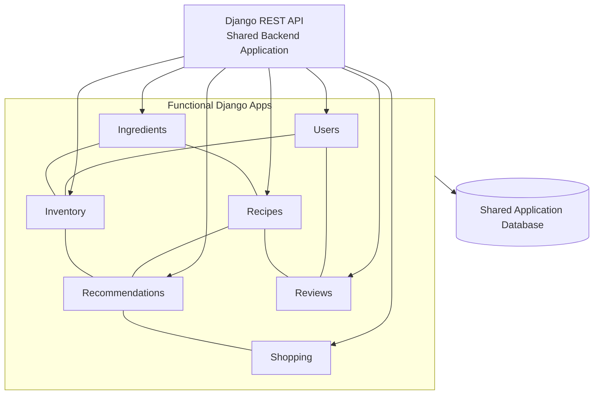

**Figure 2. Logical Django Backend Structure.** The diagram illustrates the functional separation of Django apps and their primary relationships. All apps operate within the same backend application and share database infrastructure. Connections represent logical dependencies rather than independently deployed services.

#### Shared Data and Module Integration

Although the backend is divided into functional apps, related modules communicate through shared Django models and application-level interfaces.

A key design decision is the use of a **canonical `Ingredient` model**, which provides consistent ingredient identifiers across Recipes, Inventory, Recommendations, and Shopping. This prevents duplicate representations of the same ingredient and simplifies integration between modules.

The modular structure also supports parallel development. Team members can implement and test separate Django apps independently, with integration occurring as shared models and interfaces become available.

This design provides the maintainability benefits of modular development without the additional deployment and communication complexity of a microservices architecture.

### 2.6 Frontend Application Structure

The React frontend follows a component-based, feature-oriented architecture. Application functionality is organized into separate feature modules, while reusable UI components, shared layouts, and API utilities provide consistency across the application.

This structure supports parallel frontend development, code reusability, and maintainability as new features are integrated.

#### Frontend Organization

| Area | Responsibility |
|---|---|
| **App and Routing** | Application initialization, route definitions, and page navigation using React Router |
| **Pages** | Page-level views such as Home, Recipe Details, Dashboard, Profile, and Not Found |
| **Features** | Feature-specific components and logic for Ingredients, Recipes, Recommendations, Inventory, and User Profiles |
| **Common Components** | Reusable interface elements such as buttons, inputs, cards, and loading indicators |
| **Layout Components** | Shared page structures such as navigation bars, headers, and footers |
| **API Services** | Centralized communication with Django REST API endpoints |
| **Styles and Theme** | Shared design tokens, colors, typography, and responsive styling |

#### Frontend Component Structure

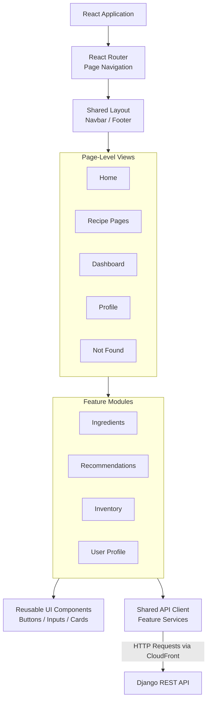

**Figure 3. Logical React Frontend Structure.** The diagram illustrates how application routing, page-level views, reusable components, and feature modules are organized. Feature services communicate with the Django backend through a shared API client.

#### Component Reusability and API Integration

The frontend separates reusable interface components from feature-specific functionality. Shared components provide consistent styling and behavior across pages, reducing duplicated code and simplifying future UI changes.

API communication is centralized through a shared client and feature-specific service modules. This keeps backend request logic separate from presentation components and provides a consistent approach to handling API responses and errors.

React Router manages navigation between pages without requiring a full page reload. During production deployment, the application is compiled into static assets and served through Amazon S3 and CloudFront, as described in Section 2.2.

Overall, the frontend architecture supports independent feature development while maintaining a consistent user interface and a clear separation between presentation logic and backend communication.

### 2.7 Planned automated deployment workflow

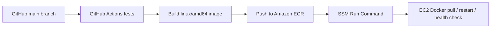

**Figure 3. Proposed CI/CD workflow, not yet implemented or verified. Current application deployments are manual.**

## 3. Implementation Progress

As of October 16, 2026, the team has completed the foundational application development, initial AWS deployment, and team access-control configuration required for the midpoint evaluation.

The current implementation demonstrates a working React frontend, a containerized Django backend, cloud-based request routing, and centralized AWS identity management. Additional application features and deployment automation remain under development for the final evaluation.

### 3.1 Application Development

The team manages development through GitHub Issues, pull requests, and feature branches. Tasks are distributed across backend, frontend, infrastructure, and security workstreams, allowing team members to develop and test components in parallel.

The completed work includes:

- **Backend foundation:** Django project structure, canonical Ingredient model and API, user profiles, preferences, and initial automated tests.
- **Frontend foundation:** React Router, shared layouts, reusable UI components, consistent styling, and centralized API services.
- **Infrastructure integration:** Dockerized Django backend, Amazon ECR image repository, EC2 deployment, and React hosting through S3 and CloudFront.
- **Security and access management:** AWS IAM Identity Center configuration, team permission sets, and AWS SSO-based access.

**Figure 4. GitHub Midpoint Milestone Progress**

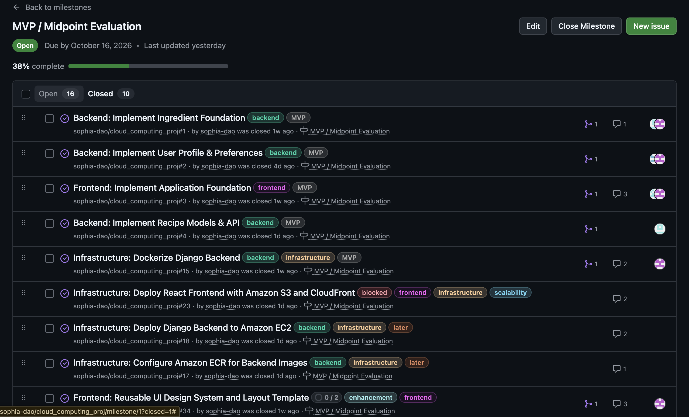

The GitHub milestone provides a consolidated record of completed development tasks and remaining work. Individual issue details, implementation discussions, and verification results are maintained in the project repository.

**Figure 5. React Application Interface**

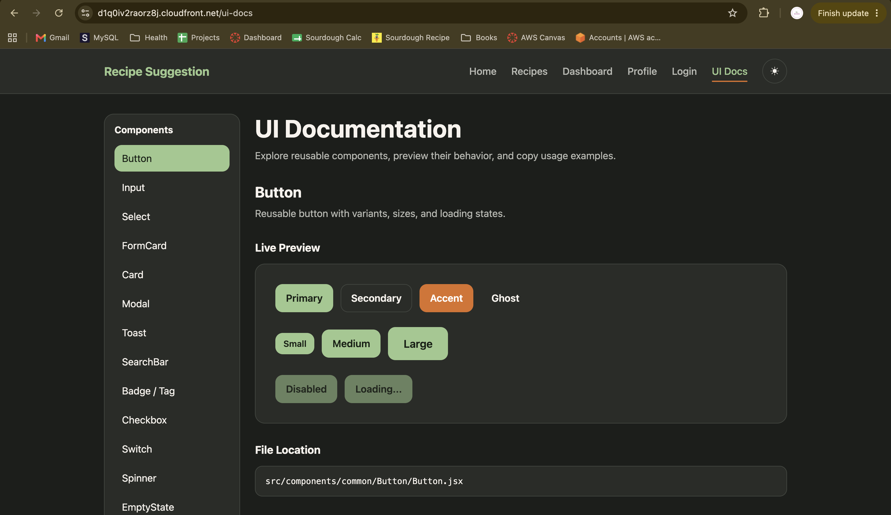

The frontend demonstrates the application's visual foundation and component-based structure. Additional feature pages and backend integrations will be completed as development progresses.

### 3.2 AWS Infrastructure and Deployment Verification

The team has successfully deployed the React frontend and Django backend to AWS. The application is accessible through a single CloudFront distribution, which serves static frontend assets from S3 and forwards API requests to the EC2 backend.

The deployed infrastructure includes:

- **Networking and compute:** VPC, public subnet, Internet Gateway, route tables, and EC2.
- **Backend deployment:** Docker, Gunicorn, Nginx, and Amazon ECR.
- **Frontend hosting:** Private Amazon S3 bucket, CloudFront, and Origin Access Control.
- **Infrastructure management:** AWS CloudFormation and Systems Manager Session Manager.

#### Deployment Verification

The React frontend and Django backend have been successfully deployed to AWS and are accessible through the same CloudFront distribution.

**Public Deployment URLs:**

| Component | URL |
|---|---|
| **React Frontend** | [https://d1q0iv2raorz8j.cloudfront.net/](https://d1q0iv2raorz8j.cloudfront.net/) |
| **Django REST API** | [https://d1q0iv2raorz8j.cloudfront.net/api/ingredients/](https://d1q0iv2raorz8j.cloudfront.net/api/ingredients/) |

**Verification Results:**

| Verification | Result |
|---|---|
| React frontend accessible through CloudFront | Passed — HTTPS |
| Django Ingredient API accessible through CloudFront | Passed — HTTP 200 |
| CloudFront `/api/*` routing to EC2 | Passed |
| React client-side route refresh | Passed — HTTP 200 |
| Missing ingredient API request | Passed — JSON HTTP 404 |
| Missing static asset handling | Passed — HTTP 403/404 |
| Dockerized Django running on EC2 | Verified |
| EC2 administration through Systems Manager | Verified |

**Figure 6. React Application Successfully Delivered Through CloudFront over HTTPS**

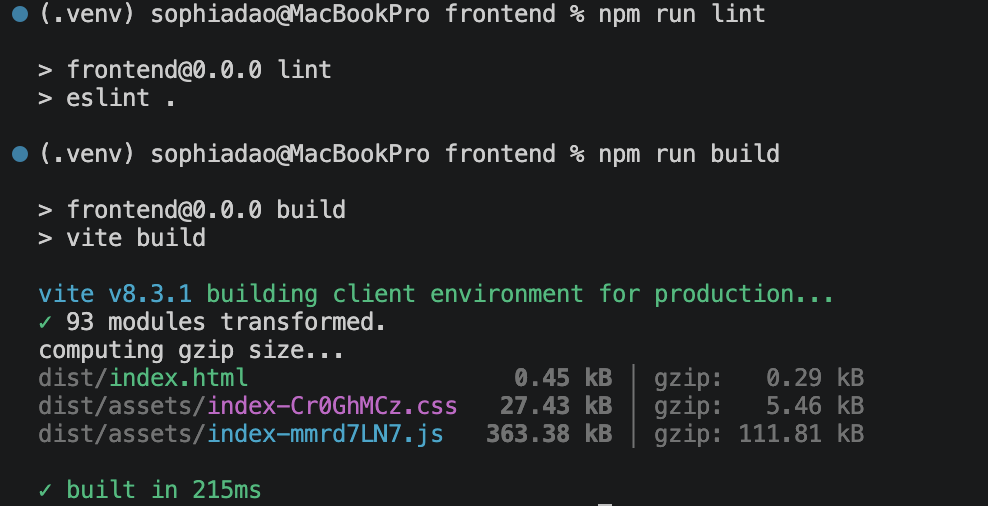

**Figure 6.1. Django Ingredient API Returning a Valid JSON Response Through the Same CloudFront Distribution, Demonstrating Successful Backend Connectivity and Request Routing**

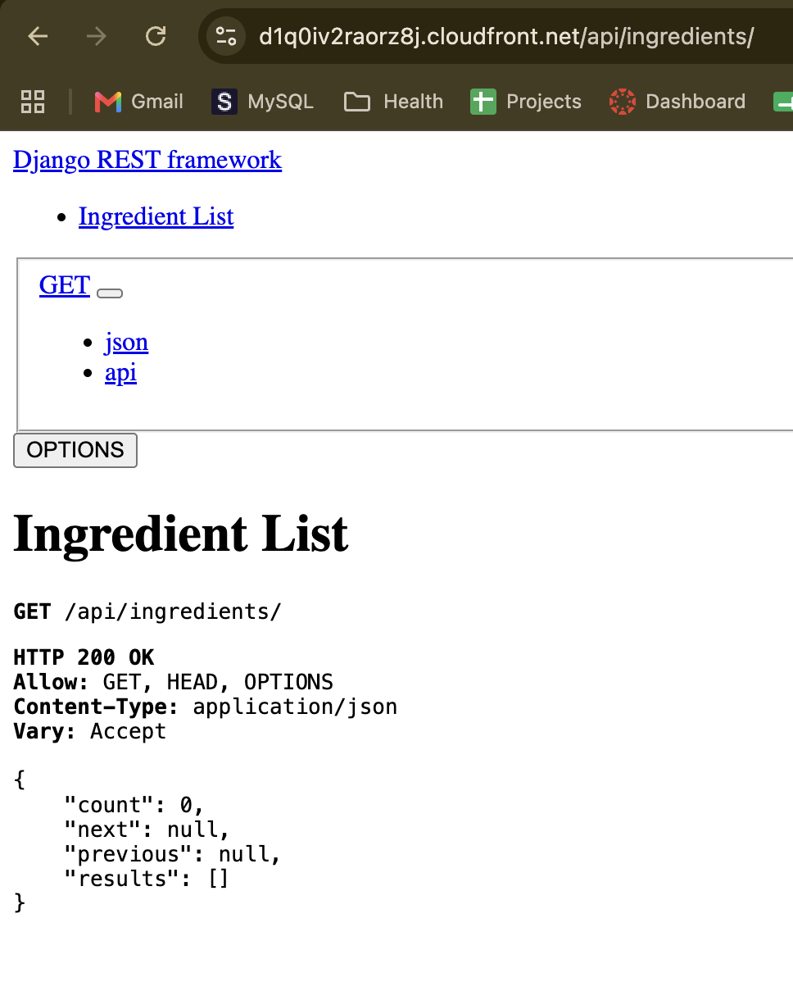

These tests confirm that frontend content and backend API requests are successfully served through the same CloudFront domain. The deployment also preserves appropriate API error responses rather than incorrectly returning React HTML.

The Ingredient API currently returns an empty paginated list because the deployed database has not yet been populated with ingredient records. Although the frontend and backend are operational, the complete ingredient-selection and recipe-recommendation workflow has not yet been integrated and verified end-to-end.

**Figure 7. AWS CloudFront Distribution Configuration**

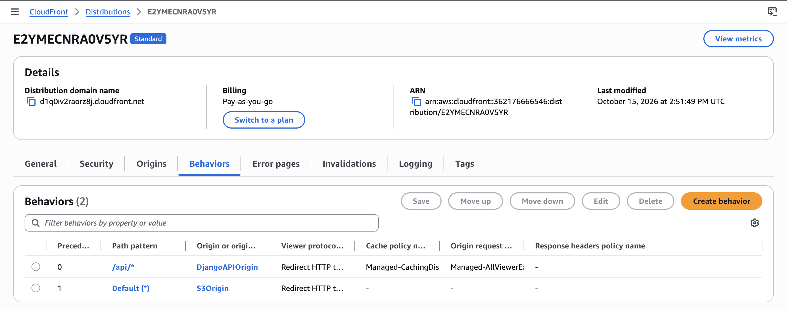

Infrastructure provisioning is managed through AWS CloudFormation, while backend container images are stored in Amazon ECR. Application releases are currently performed manually, with automated testing and deployment planned for the final phase.

### 3.3 AWS IAM Identity Center and Team Access Control

The team has completed the IAM Identity Center configuration to establish centralized, role-based AWS access for project development.

Instead of sharing AWS credentials, team members use individual identities and AWS Single Sign-On (SSO) to access authorized resources. Permission sets are assigned according to development responsibilities.

#### Access Control Configuration

| Permission Set | Responsibility |
|---|---|
| `AdministratorAccess` | AWS infrastructure administration and resource management |
| `RecipeApp-BackendDev` | Backend-related AWS resources and deployment operations |
| `RecipeApp-FrontendDev` | Frontend hosting resources, including S3 and CloudFront |

The configuration supports separation of responsibilities and provides a foundation for least-privilege access control.

The implementation includes IAM Identity Center users and groups, AWS account assignments, permission sets, and AWS CLI authentication using temporary credentials.

**Figure 8. IAM Identity Center Configuration**

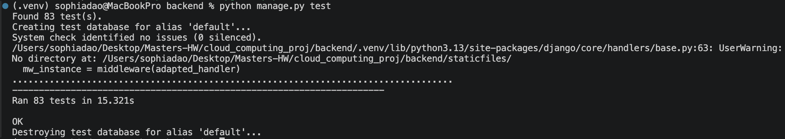

**Figure 9. AWS CLI SSO Verification of admin user with AdministratorAccess permission sets**

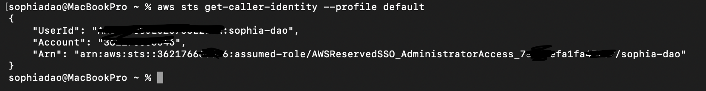

These configurations demonstrate centralized identity management and AWS access without relying on shared, long-lived IAM access keys.

### 3.4 Midpoint Summary

The midpoint implementation establishes the technical foundation required for continued development of the Recipe Suggestion App.

The frontend and backend are deployed on AWS, core application structures are implemented, and centralized team access management is configured.

The next development phase will focus on completing application workflows, integrating authentication and persistent database services, expanding automated testing, and improving deployment automation, security, and scalability.

## 4. Testing and Evidence

Testing during the midpoint phase focused on verifying core backend functionality, frontend build stability, container execution, and successful communication between deployed AWS components.

The team performed local application tests, Docker smoke tests, and public endpoint verification to confirm that the foundational system operates as expected.

### 4.1 Local Application Testing

The Django backend was tested locally using its automated test framework and direct API requests.

Testing covered ingredient search, case-insensitive matching, ingredient detail retrieval, user/profile functionality, and expected HTTP error responses for invalid or unsupported requests.

The React frontend was also checked through local development and production build processes to verify that the application compiles successfully and its foundational components render correctly.

**Figure 10. Backend Local Tests**

**Figure 10.1. Frontend Build Test**

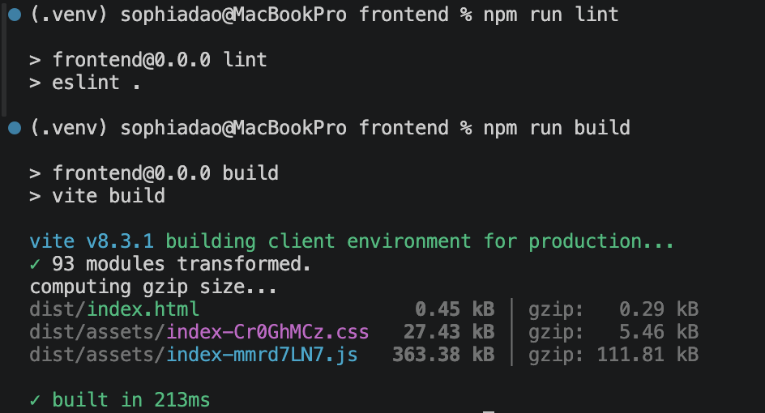

### 4.2 Container and Cloud Deployment Testing

The Dockerized Django backend was tested locally before deployment to AWS. Database migrations were applied, and the application successfully returned HTTP 200 responses from the test container.

Following deployment, public endpoint tests were performed through CloudFront to verify communication between the frontend, API routing layer, Nginx, and Django backend.

These tests confirmed:

- Successful HTTPS delivery of the React frontend.
- Successful HTTP 200 responses from the Django Ingredient API.
- Correct JSON HTTP 404 responses for nonexistent ingredients.
- Successful React client-side route handling.
- Appropriate error responses for nonexistent static assets.

**Figure 12. Successful HTTP 200 Response from the Django Ingredient API**

**Figure 12.1. Correct JSON HTTP 404 Response for a Nonexistent Ingredient**

**Figure 12.2. Successful React Client-Side Route Handling**

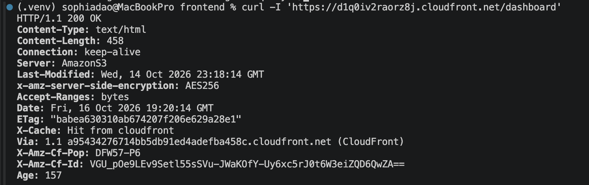

### 4.3 Testing Scope and Limitations

The completed tests demonstrate that the foundational application components and AWS deployment are functioning as expected.

However, the current tests primarily cover individual components, API behavior, and deployment connectivity. Full end-to-end recipe recommendation workflows, Cognito-protected API requests, and load/scalability benchmarking have not yet been completed.

These areas will be addressed during the final development phase as additional application features and integrations become available.

## 5. Challenges and Lessons Learned

During the midpoint phase, the team encountered several challenges related to AWS infrastructure configuration, containerized backend deployment, and frontend-to-backend integration. Resolving these issues provided practical experience in debugging cloud environments and validating application behavior.

### 5.1 Key Technical Challenges

| Challenge | Resolution and Lesson Learned |
|---|---|
| **CloudFormation Deployment and Configuration** | Infrastructure updates occasionally failed due to invalid resource configurations, parameter handling, or service-specific requirements. The team learned to validate templates, review change sets, and troubleshoot stack events before applying changes to running resources. |
| **Containerized Django Deployment** | The initial backend deployment required database migrations, correct environment variables, and proper Nginx-to-Gunicorn configuration. These issues highlighted the importance of consistent runtime configuration and repeatable deployment procedures. |
| **CloudFront Routing and Error Handling** | Initial CloudFront error-response settings caused backend API errors to return React HTML with HTTP 200 instead of the correct JSON responses. The team resolved this by implementing a CloudFront Function for frontend routes and preserving API-specific error handling. This reinforced the importance of testing both successful and unsuccessful requests. |

### 5.2 Remaining Development Challenges

Although the team has established a working cloud deployment and foundational application structure, **a substantial portion of the application remains under development**.

The primary remaining tasks include:

- **Core application functionality:** Complete recipe management, ingredient selection, inventory, recommendations, shopping lists, and other user-facing workflows.
- **Frontend and backend integration:** Connect React features to Django API endpoints and verify complete user interactions.
- **Authentication and database:** Integrate Amazon Cognito and migrate from SQLite to Amazon RDS PostgreSQL.
- **Deployment and security:** Introduce automated CI/CD workflows, improve backend HTTPS connectivity, and strengthen production configuration.
- **Testing and scalability:** Expand automated testing, perform end-to-end verification, and evaluate system performance under increasing workloads.

These tasks represent the primary development priorities leading up to the final evaluation.

### 5.3 Lessons Learned

The midpoint implementation demonstrated that successful cloud infrastructure deployment does not necessarily mean the application is functionally complete.

The team learned the importance of separating infrastructure provisioning, runtime verification, and application-level testing. It also highlighted the value of modular development, clear team responsibilities, and maintaining consistent configuration across local and cloud environments.

Moving forward, the main priority is to build upon the deployed infrastructure and complete the remaining application functionality while improving reliability, security, and deployment automation.

## 6. Security and Scalability

### 6.1 Implemented Security Measures

Security has been considered throughout the infrastructure deployment, with controls implemented across network access, application hosting, container execution, and AWS identity management.

| Area | Implemented Security Measures |
|---|---|
| **HTTPS and Content Delivery** | CloudFront provides HTTPS access for users and redirects HTTP requests to HTTPS. |
| **Frontend Storage** | The React frontend is stored in a private S3 bucket with public access blocked. CloudFront uses Origin Access Control (OAC) to securely retrieve frontend assets. |
| **Backend Network Access** | EC2 inbound HTTP access is restricted to the AWS-managed CloudFront origin-facing prefix list rather than the entire internet. |
| **Origin Request Validation** | CloudFront includes a private `X-Recipe-Origin-Key` header that Nginx validates before forwarding API requests. |
| **Container Isolation** | Django runs inside Docker, with Gunicorn accessible only through the EC2 host's loopback interface. Nginx handles incoming HTTP requests. |
| **Identity and Access Management** | IAM Identity Center provides centralized team access through permission sets and temporary SSO credentials. EC2 uses IAM roles, and Systems Manager enables administration without inbound SSH. |
| **Infrastructure Protection** | ECR image scanning and immutable tags, encrypted EC2 storage, and IMDSv2 requirements provide additional protection. |

These measures establish a security foundation for the current deployment while reducing unnecessary public exposure and reliance on long-lived AWS credentials.

### 6.2 Current Security Limitations

Although browser-to-CloudFront communication is encrypted using HTTPS, the current CloudFront-to-EC2 connection uses HTTP. The private origin header provides an additional request validation mechanism but does not replace transport encryption or application authentication.

The planned improvement is to configure HTTPS for backend origin traffic, potentially through an Application Load Balancer with AWS Certificate Manager. Amazon Cognito integration and Django authorization checks will also be required before supporting authenticated user workflows.

Until these improvements are implemented and verified, the deployed application is intended for demonstration using nonsensitive data rather than production use.

### 6.3 Scalability and Availability

The current infrastructure supports scalable static content delivery through CloudFront and S3. However, backend processing is limited to a single EC2 `t3.micro` instance, with SQLite providing temporary database storage.

This configuration is sufficient for the midpoint demonstration but does not provide automatic backend scaling or high availability.

Future scalability improvements may include:

- Migrating to Amazon RDS PostgreSQL for managed relational database storage.
- Introducing an Application Load Balancer and EC2 Auto Scaling across multiple Availability Zones.
- Implementing CloudWatch monitoring and health checks.
- Conducting repeatable load tests to measure throughput, response times, error rates, and resource utilization.

No backend load-testing results or automatic-scaling capabilities are claimed at midpoint. Performance measurements will be collected during the final development phase to evaluate system limitations and support future infrastructure decisions.

---

## 7. Remaining Work and Development Priorities

Although the team has completed the foundational application architecture and AWS deployment, substantial development remains before the final evaluation.

The remaining tasks are organized by priority to focus on delivering a functional application while improving security, reliability, and scalability.

| Priority | Development Area | Planned Work |
|---|---|---|
| **High** | Core Application Features | Complete recipe management, inventory, recommendations, shopping lists, and essential user workflows. |
| **High** | Frontend–Backend Integration | Connect React feature modules to Django APIs and verify a complete ingredient-to-recipe recommendation journey. |
| **High** | Authentication and Authorization | Integrate Amazon Cognito and enforce user ownership and role-based permissions in Django. |
| **High** | Database Persistence | Migrate from SQLite to Amazon RDS PostgreSQL for persistent application data. |
| **Medium** | Security Improvements | Enable HTTPS between CloudFront and the backend origin and validate access-control configurations. |
| **Medium** | CI/CD Automation | Implement GitHub Actions workflows for automated testing, container builds, ECR publishing, and application deployment. |
| **Medium** | Monitoring and Media Storage | Configure CloudWatch monitoring and implement required S3 media storage functionality. |
| **High** | Scalability Evaluation | Perform load testing and collect numerical performance measurements to evaluate system capacity. |
| **High** | Final Testing and Documentation | Complete regression tests, update technical documentation, and prepare a reproducible final demonstration. |

The immediate priority is to establish a working end-to-end recommendation workflow. Infrastructure improvements and additional features will be integrated alongside core application development, subject to available time and team resources.

---

## 8. Plan Through Final Submission

<text>**Final Evaluation Deadline: November 13, 2026**</text>

| Phase | Focus | Expected Outcome |
|---|---|---|
| **Midpoint — October 16** | Complete foundational development, AWS deployment, and initial verification. | Working React frontend and Django API hosted on AWS, with documented infrastructure and security configuration. |
| **Core Integration — October 17–30** | Complete essential backend features and connect React interfaces to live APIs. | Functional ingredient selection, inventory, and recipe recommendation workflow. |
| **Security and Optimization — October 31–November 6** | Integrate authentication and persistent storage, improve origin security, introduce deployment automation, and conduct initial performance testing. | More secure and reliable application with measurable performance results. |
| **Final Verification — November 7–13** | Perform regression and end-to-end testing, resolve critical issues, update documentation, and prepare the demonstration. | Verified application functionality, finalized report, and reproducible final presentation. |

The team will prioritize completing the core user experience before introducing optional enhancements. Any remaining limitations will be documented and evaluated against the final project requirements.

---

## 9. Midpoint Conclusion

As of October 16, 2026, the Recipe Suggestion App has progressed from its initial proposal to a modular Django and React application with a working AWS deployment.

The team has established the backend and frontend foundations, implemented reusable application components, deployed Django through Docker and Amazon EC2, and configured Amazon S3 and CloudFront for frontend hosting and API routing. AWS infrastructure is managed through CloudFormation, and IAM Identity Center provides centralized team access management.

The midpoint verification demonstrates that the deployed React frontend and Django REST API are accessible through a shared HTTPS CloudFront domain. Successful API requests return valid JSON responses, invalid ingredient requests preserve appropriate HTTP errors, and React client-side navigation functions correctly.

These accomplishments establish a functional cloud infrastructure and a foundation for continued application development.

However, the application is not yet feature-complete or production-ready. The remaining development phase will focus on completing the recipe recommendation workflow, integrating authentication and persistent storage, strengthening security, automating deployments, and collecting measurable scalability results.

**Overall, the midpoint evaluation demonstrates successful cloud infrastructure deployment and foundational application development, with a clear implementation plan toward the November 13 final evaluation.**