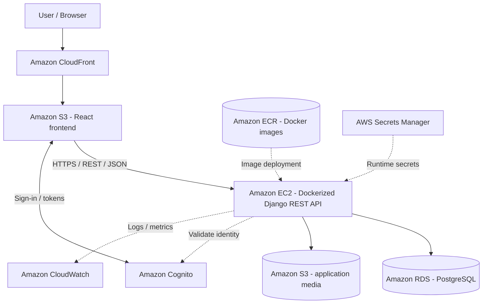
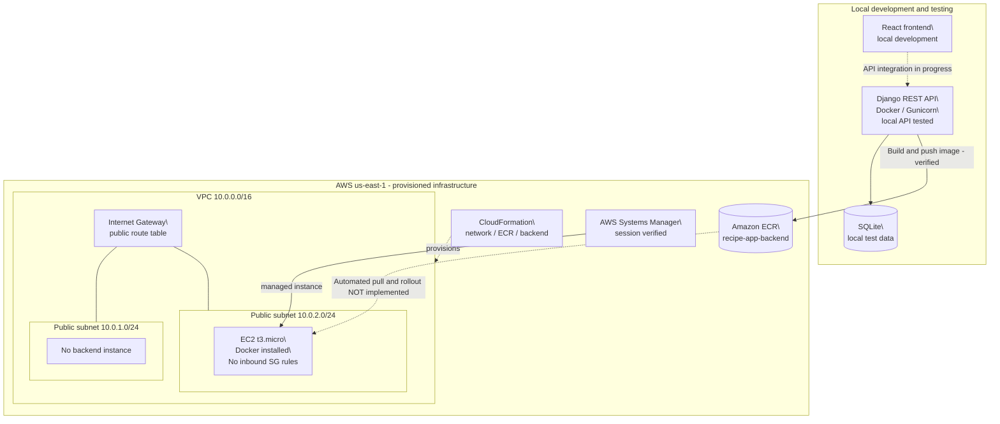
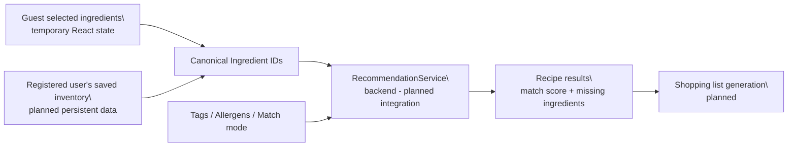
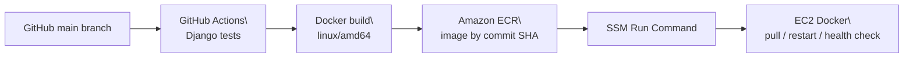

# Recipe Suggestion App — Midpoint Evaluation Report

**Course:** Cloud Computing  

**Evaluation date:** October 16, 2026  

**Final project deadline:** November 13, 2026  

**Repository:** https://github.com/sophia-dao/cloud_computing_proj  

**Group members:** Sophia Dao, Burhan Khokhar, Brooke Sayer, Huy Le

> **Status convention:**  

> **Implemented:** code or infrastructure exists   

> **Verified:** an observed test or check passed   

> **Planned:** not yet implemented. This report documents progress, not a claim that the entire application is deployed. 

## 1. Project overview

The Recipe Suggestion App aims to reduce household food waste by helping users find recipes based on ingredients they already have. Instead of searching for recipes first and then purchasing every required ingredient, users can provide their available ingredients and receive suitable suggestions. The system is designed to support food preferences, allergies, and cuisine choices.

The planned user roles are **Guest**, **Registered User**, and **Administrator**. Guests can select ingredients and explore recommendations without a permanent account. Registered users are intended to manage saved inventory, recipes, shopping lists, and profile preferences. Administrators will have additional management capabilities. Two planned recommendation modes are **AVAILABLE_ONLY** (recipes that can be made with available ingredients) and **PARTIAL_MATCH** (recipes that require some additional ingredients).

## 2. Architecture and changes from the original plan

### 2.1 Original system design and initial AWS decisions

The original architecture, documented in [`README.md`](../README.md), [`system-design.md`](system-design.md), and [`aws-architecture.md`](aws-architecture.md), specified a **client-server application with a modular-monolith Django backend**, not microservices. The team planned to separate frontend presentation, backend business logic and authorization, authentication identity, relational data, and media storage.

The initial AWS architecture already selected:

- **React on Amazon S3 and CloudFront** for static frontend hosting and HTTPS content delivery.
- **One Amazon EC2 instance running Dockerized Django REST Framework** for a manageable initial backend deployment.
- **Amazon ECR** for storing and distributing backend Docker images.
- **PostgreSQL on Amazon RDS** for persistent relational data separate from backend compute.
- **Amazon Cognito** for authentication, with Django enforcing application authorization.
- **Amazon S3** for persistent recipe and profile media.
- **AWS Secrets Manager and CloudWatch** for planned secrets handling and monitoring.
- **Amazon VPC and security groups** for network access controls.

The original design intentionally **did not require an Application Load Balancer, EC2 Auto Scaling, multiple backend instances, or microservices** for the first release. These were reserved as possible future improvements based on measured demand.

*Figure 1. Original target AWS architecture, including decisions made during initial planning. This is a **design diagram**, not a claim that all services are currently deployed.*

### 2.2 Initial architectural decisions and rationale

These choices were **made during the original planning phase** and should not be presented as changes introduced at midpoint.

**1. Why a modular monolith instead of microservices?** A small team can organize Django into separate domains—Users, Ingredients, Recipes, Inventory, Recommendations, Reviews, and Shopping—without operating multiple independently deployed services. The shared canonical Ingredient model also benefits from consistent backend data rules.

> **Trade-off:** Application domains share one deployment and initially scale together. Independent services can be considered later only if there is a demonstrated need.

**2. Why a single EC2 instance for the backend?** The initial AWS design explicitly selected EC2 to keep compute and deployment understandable for a class project with limited expected traffic. Docker allows the application runtime to be reproduced and replaced. Managed alternatives such as App Runner or ECS were considered, but were not part of the selected initial architecture.

> **Trade-off:** EC2 gives direct control over the host and networking but requires instance maintenance, deployment operations, and health monitoring. A single instance does not provide high availability or automatic scaling.

**3. Why Docker and Amazon ECR?** Docker packages the Django application and dependencies into a consistent runtime. ECR stores deployable images separately from the EC2 instance, supporting repeatable releases and eventual CI/CD.

> **Trade-off:** Building and storing an image does not automatically configure secrets, initialize a database, or start a healthy service.

**4. Why PostgreSQL on Amazon RDS?** The original design separates persistent relational data from disposable application containers. This allows backend instances to be restarted or replaced without making their local disks the authoritative application database.

> **Trade-off:** RDS introduces database configuration, networking, operational cost, and connectivity work. It remains the target architecture even though it has not yet been deployed.

**5. Why S3 and CloudFront for the frontend and media?** Static React assets do not need a Django server to deliver them. S3 and CloudFront separate frontend delivery from backend compute, while application media can persist in S3 independently of the container.

> **Trade-off:** Separate hosting origins require correct API routing, CORS, HTTPS, and storage permissions during integration.

**6. Why Cognito for authentication and Django for authorization?** Cognito is intended to manage user identity and sign-in, while Django owns application profiles, resource ownership, roles, and permissions. This avoids treating authentication tokens or frontend visibility rules as sufficient authorization.

> **Trade-off:** Cognito identity mapping and protected API requests require careful integration and testing; that work is not yet verified at midpoint.

**7. Why defer load balancing and Auto Scaling?** The original design prioritized a simple initial deployment while leaving a path to multiple stateless Django instances behind an Application Load Balancer when justified by usage.

> **Trade-off:** The current single-instance deployment cannot tolerate instance failure automatically, and horizontal scaling remains a design goal rather than an implemented feature.

### 2.3 Architecture evolution and implementation decisions

The team has **retained the original application and AWS service choices**. The meaningful midpoint refinements involve how infrastructure is provisioned, how EC2 is administered, and which integrations are implemented first.

| Area | Original plan | Midpoint implementation / adjustment | Reason and trade-off |
| --- | --- | --- | --- |
| Infrastructure provisioning | AWS resources and networking defined conceptually | **CloudFormation** stacks for networking, ECR, backend EC2, and OIDC configuration | Repeatable, reviewable Infrastructure as Code; additional template development and troubleshooting |
| Availability Zones | Single backend instance; subnet topology could evolve | Added a **second public subnet in another AZ** after an EC2 instance-type availability issue | Allows deployment in an available AZ; two subnets alone do not provide high availability |
| EC2 administration | Secure IAM and network access required | **AWS Systems Manager Session Manager** used and verified | Administrative access without inbound SSH; depends on IAM and SSM configuration |
| Application server | Dockerized Django on EC2 | **Gunicorn** configured inside the Docker image | More suitable than Django's development server; still requires runtime health checks and configuration |
| Database rollout | **RDS PostgreSQL** selected as persistent storage | **SQLite used for local testing**, RDS not yet provisioned | Unblocks API and Docker tests; SQLite is temporary and not a replacement for RDS |
| CI/CD implementation | GitHub Actions integration considered for future automation | GitHub Actions and OIDC CloudFormation deployment postponed until after midpoint | Prioritize application functionality and core AWS infrastructure before deployment automation |
| Frontend and authentication rollout | S3/CloudFront and Cognito selected initially | React foundation and user/profile work tested locally; cloud integrations pending | Enables incremental testing; end-to-end integration remains a schedule risk |

**Why CloudFormation?** Rather than configuring resources only through the AWS Console, the team introduced version-controlled templates for networking, ECR, and compute. This makes dependencies visible and allows changes to be reviewed and reproduced. The extra subnet was added after the initial EC2 deployment encountered an Availability Zone capacity restriction.

> **Trade-off:** Infrastructure as Code improves consistency but requires time to validate and debug templates.

**Why Systems Manager and GitHub OIDC?** Session Manager allows the team to inspect the EC2 instance without exposing an SSH port. GitHub OIDC prepares for federated, short-lived AWS credentials instead of storing permanent access keys in GitHub secrets.

> **Trade-off:** Both require carefully scoped IAM permissions. Session Manager access has been verified, but the GitHub Actions deployment workflow is **not implemented**.

**Why stage RDS, Cognito, frontend hosting, and deployment automation?** With the midpoint deadline approaching, the team prioritized verifiable foundations: Django APIs, reusable React components, local Docker execution, an ECR image, and provisioned AWS resources. This is a **change in implementation order**, not a change to the selected production architecture.

> **Trade-off:** A locally working prototype and provisioned cloud infrastructure do not yet form a complete cloud-hosted application. The remaining integration work must be completed and tested before final submission.

The project scope and modular-monolith design remain unchanged. The midpoint demonstrates **staged implementation of the original architecture**, with a small number of practical infrastructure refinements.

### 2.4 Current midpoint architecture — provisioned versus running

_*Figure 2. Verified midpoint infrastructure and local prototype. Dashed links indicate incomplete integration or provisioning relationships rather than confirmed application traffic. The EC2 host is provisioned, but Django running on EC2 and a public API endpoint have _**not**_ been verified.*_

### 2.5 Application architecture retained from the original design

The backend continues to use **domain-oriented Django modules**. The original design defines a shared canonical `Ingredient`, reusable `Tag` classifications, and separate `Allergen` entities. Both Guest and Registered User recommendation flows are designed to use the same backend `RecommendationService` with `AVAILABLE_ONLY` and `PARTIAL_MATCH` modes.

_*Figure 3. Intended recommendation data flow from the original system design. The Ingredient API foundation has been implemented; this diagram does _**not**_ claim that the full recommendation service is complete.*_

### 2.6 Planned automated deployment workflow (not yet operational)

_*Figure 4. Proposed CI/CD pipeline. The GitHub OIDC provider exists, but the GitHub Actions workflow and automated EC2 rollout are _**not implemented**_ as of the midpoint.*_

## 3. Implementation progress

### 3.1 Application code

\| Component | Current progress | Evidence / limitation |

\| --- | --- | --- |

\| Django REST backend foundation | Implemented | Local Django server and tests have been run |

\| Canonical Ingredient API | Implemented and verified | Case-insensitive search, detail lookup, validation of unsupported methods, and automated tests |

\| User/profile backend | Partially implemented and tested | Recent checks passed; Cognito authentication not yet verified |

\| React application foundation | Implemented | Routing, reusable components, theme, and a custom 404 page have been worked on |

\| Recipes, inventory, recommendations, saved recipes | Defined in GitHub issues and system design | Do not claim completion without confirming merged implementations |

\| Full frontend-to-backend integration | In progress | Requires a verified end-to-end walkthrough |

The **canonical Ingredient** design is a shared foundation: inventory, recipes, and recommendations are intended to reference the same ingredient records rather than create inconsistent duplicate names.

### 3.2 AWS infrastructure and deployment preparation

\| Resource / practice | Current status | Verification performed |

\| --- | --- | --- |

\| VPC, Internet Gateway, route table, two public subnets | Deployed | CloudFormation network stack deployed and updated |

\| EC2 backend instance (`t3.micro`) | Deployed | Backend stack completed successfully |

\| Docker on EC2 | Verified | Docker version and service status checked via SSM |

\| AWS Systems Manager | Verified | Interactive session to EC2 established without inbound SSH |

\| Amazon ECR | Deployed | `recipe-app-backend:midpoint-v1` image pushed |

\| Dockerized Django | Verified locally | API returned HTTP 200 after applying migrations in test container |

\| GitHub OIDC identity provider | Created and verified | Provider ARN returned by IAM CLI |

\| GitHub deployment role | Template prepared; deployment verification pending | Confirm stack status and role ARN before marking verified |

\| GitHub Actions deployment workflow | Not implemented | Work intentionally paused for midpoint documentation |

\| Amazon RDS | Not implemented | SQLite currently used in local prototype |

\| AWS-hosted React frontend | Not verified | S3/CloudFront hosting remains planned |

**Infrastructure specifics:** AWS region `us-east-1`; VPC CIDR `10.0.0.0/16`; public subnets `10.0.1.0/24` and `10.0.2.0/24`. The backend EC2 security group has no inbound rules at the midpoint, so public access to Django is not yet available. The EC2 instance uses an IAM role for SSM and scoped ECR image retrieval.

## 4. Testing and evidence

Completed checks reported during development include:

1. **Ingredient API:** Case-insensitive ingredient search succeeded. Requests for nonexistent ingredient IDs returned HTTP 404, and unsupported POST requests returned HTTP 405, as intended.

2. **Automated Django tests:** Ingredient tests and recent user/profile checks passed locally. Record the latest test count and command output before the presentation rather than relying on an older count.

3. **Docker smoke test:** A Django Docker container responded with HTTP 200 for `GET /api/ingredients/` after database migrations were applied. This also exposed an important startup dependency: a new SQLite database must be migrated before the API can serve database-backed requests.

4. **AWS provisioning:** Network, ECR, and backend EC2 CloudFormation stacks completed. Docker and Systems Manager were checked on the instance.

5. **Container registry:** A backend image was built for `linux/amd64` and pushed to Amazon ECR.

6. **OIDC identity:** AWS IAM returned the GitHub OIDC provider, establishing that the identity provider was created. This does **not** prove an end-to-end GitHub Actions deployment.

**Evidence to attach before submission:** screenshots or terminal excerpts showing the Django test summary, successful Ingredient API response, frontend UI, Docker test, CloudFormation stack status, ECR image tag, EC2 instance, and SSM connection. Remove tokens, secret values, and unnecessary personal/account information from screenshots.

## 5. Challenges and lessons learned

**Availability Zone and EC2 instance compatibility.** The first EC2 provisioning attempt failed because the selected instance type was unavailable in the initial subnet's Availability Zone. The team added a second public subnet in another Availability Zone and deployed the backend instance there. This highlighted the importance of validating region/AZ capacity and designing flexible network infrastructure.

**Database initialization in containers.** A locally built Docker container initially produced server errors because its SQLite database schema had not been migrated. Applying Django migrations resolved the API issue. This demonstrated that container startup and database lifecycle must be handled explicitly during deployment.

**Infrastructure versus application deployment.** Provisioning an EC2 instance, installing Docker, and pushing an image to ECR are separate from running a healthy application service. The team is documenting these stages individually so progress can be verified without overstating readiness.

**Scope management.** The team prioritized the foundational API, frontend structure, repeatable infrastructure, and container packaging before completing Cognito, RDS, and CI/CD. This supports a feasible midpoint prototype but leaves integration work for the final phase.

## 6. Security and scalability

### Security practices already present

- AWS IAM roles are used for the backend instance and GitHub OIDC deployment preparation, rather than embedding long-lived credentials in source code.

- Systems Manager provides administrative access to EC2 without opening inbound SSH.

- The backend EC2 security group currently has no inbound rules.

- The backend ECR repository uses immutable image tags and image scanning on push.

- The EC2 root EBS volume is encrypted, and IMDSv2 is required.

- Sensitive runtime settings are intended to come from environment configuration rather than hard-coded production secrets.

### Current limits and planned improvements

The current architecture has **one EC2 instance**, so it is not highly available and does not automatically scale application compute. Two public subnets exist, but multiple subnets alone do not provide failover. Before final delivery, the team should evaluate an Application Load Balancer, EC2 Auto Scaling across Availability Zones, managed relational storage (RDS), HTTPS, health checks, and basic monitoring. These are **proposed improvements**, not midpoint achievements.

To address the course's scalability requirement, the final evaluation should include measurable results, such as requests per second, response-time percentiles, error rates, and resource usage under a repeatable test workload. No benchmark results are claimed at midpoint.

## 7. Remaining work and risks

\| Remaining task | Main risk | Proposed next action |

\| --- | --- | --- |

\| Integrate frontend and Django APIs | Inconsistent API contracts or unfinished UI flows | Verify one complete user journey and fix integration issues |

\| Complete recipes, inventory, and recommendation flows | Shared data/model dependencies | Prioritize an end-to-end available-ingredients recommendation |

\| Integrate and verify Cognito authentication | Authorization and profile mapping complexity | Test login, protected endpoints, and role behavior |

\| Run Django container on EC2 | Runtime configuration, migrations, service health | Deploy an image, apply migrations, and run a local-on-instance health check |

\| Implement persistent cloud storage | SQLite data loss or deployment coupling | Add and test an appropriate persistent database strategy |

\| Deploy React frontend | Hosting, routing, CORS, and HTTPS | Configure hosting and test API connectivity |

\| Complete GitHub Actions CI/CD | IAM permissions, safe secret handling, failed rollouts | Finish OIDC verification and implement tested build/push/deploy stages |

\| Measure scalability and security | Insufficient evidence for professor's criteria | Run load tests and document protections and limitations |

\| Record final demo and update documentation | Schedule and integration delays | Freeze demo scope and verify a repeatable demonstration |

## 8. Plan through final submission

**Midpoint — October 16:** Present the locally working prototype, tested APIs, Docker image, and deployed AWS foundation. Show actual logs and screenshots, with pending integrations clearly labeled.

**Next phase:** Complete a minimum end-to-end recipe recommendation journey; verify authentication and user data flows; run Django on EC2; connect frontend and backend; introduce persistent data storage.

**Finalization — by November 13:** Implement or finalize deployment automation, strengthen security and monitoring, collect scalability measurements, run regression tests, update diagrams and documentation, and record the final demonstration.

## 9. Midpoint conclusion

The project has progressed from an initial application proposal to a structured Django/React codebase, a tested Ingredient API, local Docker execution, and provisioned AWS networking, compute, registry, and management resources. The team followed its original plan to use EC2-hosted Docker, ECR, and a modular-monolith Django backend, while introducing CloudFormation-based provisioning, Systems Manager access, and a second public subnet during implementation. RDS, Cognito, frontend hosting, and deployment automation remain part of the target architecture but have been staged for later integration. These refinements established a concrete deployment foundation and revealed practical integration challenges.

The main remaining objective is to connect the existing pieces into a working cloud-hosted application, while finishing user-facing recipe workflows, authentication, persistence, automation, and measurable scalability testing. The midpoint demonstrates **partial functionality and infrastructure progress**, not a finished production system.

**---**

### Final review checklist (remove before submission)

- [ ] Verify which teammate features have actually been merged into `main`.

- [ ] Update exact test count and capture fresh test output.

- [ ] Attach screenshots and an accurate AWS architecture diagram.

- [ ] Confirm the demo reflects the same implementation state as the report.
