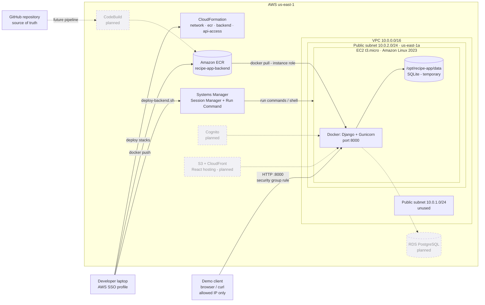

# Midpoint Evaluation — Deliverables Guide

**Issue:** #39 Midpoint Evaluation Deliverables · **Deadline:** October 16, 2026

This page is the entry point for the midpoint. It covers what is deployed, how to reproduce the cloud prototype, and how the presentation and demo video are structured.

| Document | Purpose |
| --- | --- |
| [PROGRESS.md](PROGRESS.md) | Full midpoint report: architecture decisions, progress, testing, challenges, risks |
| [infrastructure/README.md](../../infrastructure/README.md) | Detailed CloudFormation stack documentation and AWS commands |
| This page | Status summary, deployment runbook, CI/CD status, demo and presentation plan, submission checklist |

> **Status convention** (same as PROGRESS.md): **Verified** = a check was observed to pass; **Implemented** = code/template exists but has not been checked end to end; **Planned** = not implemented. Update the status column only after you see the result yourself.

## 1. Status at a glance

| Area | Item | Status |
| --- | --- | --- |
| Backend | Ingredient API (`/api/ingredients/`, search, detail) | Verified locally (automated tests) |
| Backend | User profile & preferences API (`/api/users/`) | Verified locally (automated tests) |
| Backend | Automated tests (`manage.py test`) | **Verified — 26 tests pass** (Oct 15, 2026) |
| Backend | Docker image with Gunicorn | Verified locally; `midpoint-v1` pushed to ECR |
| Frontend | React foundation, routing, UI design system | Verified locally (`npm run dev`) |
| AWS | VPC, 2 public subnets, IGW, route table (`recipe-app-network`) | Deployed |
| AWS | ECR repository (`recipe-app-ecr`) | Deployed |
| AWS | EC2 `t3.micro`, IAM role, security group (`recipe-app-backend`) | Deployed; SSM session verified |
| AWS | Django container running on EC2 (`deploy-backend.sh`) | Implemented — **run and verify before recording** |
| AWS | Restricted API port access (`recipe-app-api-access`) | Implemented — **deploy and verify before recording** |
| CI/CD | CodeBuild test stage (`buildspec.yml`) | Implemented; commands pass locally; CodeBuild project **not created** |
| CI/CD | CodePipeline (GitHub → CodeBuild → EC2) | Planned (future work) |
| AWS | RDS PostgreSQL, Cognito, S3 + CloudFront frontend, CloudWatch | Planned |

## 2. AWS architecture

The diagram shows **deployed** resources with solid borders and **planned** services with dashed borders.



**Service responsibilities**

| Service | Responsibility | Status |
| --- | --- | --- |
| CloudFormation | Provisions all AWS resources from version-controlled templates | Deployed |
| VPC / subnets / IGW | Isolated network; public subnet gives EC2 outbound access to ECR and SSM | Deployed |
| EC2 | Runs the Django container | Deployed |
| IAM instance role | SSM access and pull-only ECR access; no static keys on the instance | Deployed |
| Security group | No SSH; API port opened only to one CIDR via the `api-access` stack | Deployed (closed); `api-access` implemented |
| ECR | Immutable, scanned backend images | Deployed |
| Systems Manager | Admin shell and deployments without SSH or key pairs | Verified |
| CodeBuild / CodePipeline | Automated tests, image build and deploy | Planned (buildspec ready) |
| RDS, Cognito, S3/CloudFront, CloudWatch | Persistent DB, authentication, frontend hosting, monitoring | Planned |

## 3. Deployment runbook (reproducible)

Run from the repository root. These commands assume the `recipe-app` SSO profile and `us-east-1` from [infrastructure/README.md](../../infrastructure/README.md). Use a bash shell: macOS Terminal, Linux, or Git Bash on Windows.

```bash
aws sso login --profile recipe-app
export AWS_PROFILE=recipe-app AWS_REGION=us-east-1
```

### 3.1 Infrastructure (already deployed)

`recipe-app-network`, `recipe-app-ecr` and `recipe-app-backend` are already `CREATE_COMPLETE`. **Do not redeploy `backend.yaml` before the demo.** Its AMI comes from the "latest Amazon Linux" SSM parameter, so an update can replace the instance if a newer AMI has been released.

```bash
aws cloudformation describe-stacks \
  --query "Stacks[?starts_with(StackName,'recipe-app')].[StackName,StackStatus]" --output table
```

### 3.2 Build and push a new image (recommended)

`midpoint-v1` stores SQLite inside the container, so data is lost when the container is replaced. Images built from this branch read `DJANGO_SQLITE_PATH` and keep the database on the host volume `/opt/recipe-app/data`. Tags are immutable, so use a new tag.

```bash
ACCOUNT_ID=$(aws sts get-caller-identity --query Account --output text)
REGISTRY=$ACCOUNT_ID.dkr.ecr.us-east-1.amazonaws.com
aws ecr get-login-password | docker login --username AWS --password-stdin $REGISTRY
docker build --platform linux/amd64 -t $REGISTRY/recipe-app-backend:midpoint-v2 ./backend
docker push $REGISTRY/recipe-app-backend:midpoint-v2
```

If there is no time, `IMAGE_TAG=midpoint-v1` also works. Data is then reset on every redeploy.

### 3.3 Run Django on EC2

```bash
IMAGE_TAG=midpoint-v2 ./infrastructure/scripts/deploy-backend.sh
```

The script uses **SSM Run Command** (no SSH) to:

1. Log in to ECR with the instance role and pull the image.
2. Generate a Django secret key **on the instance** (`/opt/recipe-app/backend.env`, root-only) the first time it runs. The key is never committed.
3. Replace the `recipe-app-backend` container (`--restart unless-stopped`), run migrations, and start Gunicorn on port 8000.
4. Seed ten demo ingredients if they are missing (`SEED_DEMO_DATA=0` to skip).
5. Run `curl` against `/api/health/` and `/api/ingredients/` **from inside the instance** and print the output.

A run that ends in `Status: Success` with JSON output is the evidence for "Django backend deployed to EC2". Screenshot it.

### 3.4 Open the API to your IP only (for the demo)

```bash
SG_ID=$(aws cloudformation describe-stacks --stack-name recipe-app-backend \
  --query "Stacks[0].Outputs[?OutputKey=='SecurityGroupId'].OutputValue" --output text)
MY_IP=$(curl -s https://checkip.amazonaws.com)

aws cloudformation deploy \
  --template-file infrastructure/cloudformation/api-access.yaml \
  --stack-name recipe-app-api-access \
  --parameter-overrides BackendSecurityGroupId=$SG_ID AllowedCidr=$MY_IP/32
```

This only adds one security-group rule; the EC2 instance is not touched. The API has no authentication yet, so **do not use `0.0.0.0/0`**.

### 3.5 Verify the deployed Ingredient API

```bash
PUBLIC_IP=$(aws ec2 describe-instances \
  --instance-ids $(aws cloudformation describe-stacks --stack-name recipe-app-backend \
     --query "Stacks[0].Outputs[?OutputKey=='InstanceId'].OutputValue" --output text) \
  --query 'Reservations[0].Instances[0].PublicIpAddress' --output text)

curl -i http://$PUBLIC_IP:8000/api/health/
curl "http://$PUBLIC_IP:8000/api/ingredients/"
curl "http://$PUBLIC_IP:8000/api/ingredients/?search=TOM"   # case-insensitive search
curl -i "http://$PUBLIC_IP:8000/api/ingredients/99999/"     # expect 404
curl -i -X POST "http://$PUBLIC_IP:8000/api/ingredients/"   # expect 405
```

### 3.6 Frontend against the cloud API (optional)

CORS already allows `http://localhost:5173`, so the local React app can call the EC2 API:

```bash
cd frontend
echo "VITE_API_BASE_URL=http://$PUBLIC_IP:8000/api" > .env.local
npm install
npm run dev
```

Then open the browser DevTools → Network tab and show the request to the EC2 IP succeeding. Only claim frontend-to-backend communication if this was actually shown.

### 3.7 Close access and clean up

After the recording, close the port:

```bash
aws cloudformation delete-stack --stack-name recipe-app-api-access
```

To stop the container without removing infrastructure:

```bash
aws ssm send-command --instance-ids <instance-id> --document-name AWS-RunShellScript \
  --parameters 'commands=["docker rm -f recipe-app-backend"]'
```

Full teardown order is in [infrastructure/README.md §10](../../infrastructure/README.md#10-cleanup-destructive): `api-access` → `backend` → `network`, then `ecr` once its images are deleted. **Confirm with the team first.**

**Cost:** one `t3.micro`, 12 GiB gp3, one public IPv4 and a few ECR images cost a few dollars per month. Nothing in this runbook adds paid resources beyond those.

## 4. CI/CD

| Stage | Status | Notes |
| --- | --- | --- |
| GitHub as source of truth | Done | All code and templates are in this repository |
| Automated tests ([`buildspec.yml`](../../buildspec.yml)) | Implemented | `check`, migration-drift check, and the 26 Django tests; passes locally |
| CodeBuild project | Planned | Create in the console: source GitHub (CodeConnections), buildspec from repo, Python 3.13 standard image |
| CodePipeline: GitHub → CodeBuild → deploy | Planned | Deploy stage would build and push the image, then run the same SSM steps as `deploy-backend.sh` |
| GitHub OIDC role | Provisioned earlier, unused | Alternative path via GitHub Actions |

**Current workflow (manual, scripted):** commit → `docker build` / `push` with a new tag → `deploy-backend.sh` → verify with `curl`. This is described as a scripted manual deployment, **not** CI/CD.

## 5. Running the prototype locally

```bash
# Backend
cd backend
python -m venv .venv && source .venv/bin/activate    # Windows: .venv\Scripts\activate
pip install -r requirements.txt
export DJANGO_SECRET_KEY=local-dev-only DJANGO_DEBUG=true   # PowerShell: $env:DJANGO_SECRET_KEY="local-dev-only"
python manage.py migrate
python manage.py test          # expect: Ran 26 tests ... OK
python manage.py runserver     # http://127.0.0.1:8000/api/health/

# Frontend (second terminal)
cd frontend
cp .env.example .env.local
npm install
npm run dev                    # http://localhost:5173
```

## 6. Presentation outline (5 minutes)

Export as `Group<group-number>-<system-name>.pptx`.

| # | Slide | Time | Content |
| --- | --- | --- | --- |
| 1 | Title | 0:15 | Recipe Suggestion App, group number, members |
| 2 | Problem | 0:30 | Food waste; "what can I cook with what I have?"; target users: students |
| 3 | Solution | 0:30 | Inventory → recommendations (AVAILABLE_ONLY / PARTIAL_MATCH), filters, shopping list |
| 4 | AWS architecture | 0:45 | Diagram from §2, deployed vs. planned clearly marked |
| 5 | Implementation | 0:45 | 5 closed issues, Ingredient & Users APIs, React design system, 26 passing tests |
| 6 | Infrastructure & DevOps | 0:45 | CloudFormation stacks, Docker/ECR, SSM deploy without SSH, least-privilege IAM, buildspec |
| 7 | Challenges & lessons | 0:30 | AZ capacity → second subnet; container DB migrations; infra ≠ running app |
| 8 | Remaining work & plan | 0:45 | RDS, Cognito, recommendations, S3/CloudFront, CodePipeline, scalability testing by Nov 13 |
| 9 | Questions | 0:15 | — |

## 7. Demo video script (5–10 minutes)

Rehearse once. Record in this order so every step builds on the previous one.

1. **(0:30) Intro.** Show the GitHub repository and the issue #39 checklist.
2. **(1:30) Infrastructure as code.** Open `network.yaml`, `backend.yaml` and `api-access.yaml`. In the AWS Console, show CloudFormation stacks at `CREATE_COMPLETE`, the VPC, the EC2 instance and the ECR image tags.
3. **(1:00) Secure access.** Show the security group (only port 8000 from one IP, no port 22). Open a Session Manager shell and run `docker ps`.
4. **(1:30) Deployment.** Run `deploy-backend.sh` and walk through the SSM output: pull, migrate, healthy.
5. **(1:30) Cloud API.** Run the `curl` commands from §3.5 against the public IP: health, list, search, 404, 405.
6. **(1:00) Tests.** Run `python manage.py test` locally (26 OK). Show `buildspec.yml` and say CodeBuild is the next step.
7. **(1:00) Frontend.** Run `npm run dev` and show the UI design system pages, plus the EC2 API call in DevTools if §3.6 works.
8. **(1:00) Limitations and next steps.** SQLite on one instance, no auth on the API, no pipeline yet. Plan: RDS, Cognito, CodePipeline, S3/CloudFront.

Then close the port (§3.7). Upload the video, set sharing to "anyone with the link" (or the class domain), and test the link in a private window.

## 8. Evidence to capture

Store screenshots under `docs/midpoint/evidence/`. **Never** capture or commit credentials, the `backend.env` file, or SSO tokens.

- [ ] `manage.py test` output (26 tests OK)
- [ ] CloudFormation stack list with statuses
- [ ] `deploy-backend.sh` output ending in `Status: Success`
- [ ] `curl` responses from the public IP
- [ ] Security group inbound rules
- [ ] Frontend running locally (and the EC2 network call, if shown)

## 9. Submission checklist

- [ ] All midpoint work merged into `main`; README links here
- [ ] Status table in §1 updated to match what was actually verified
- [ ] Presentation `Group<N>-<SystemName>.pptx` uploaded via the professor's Google Form
- [ ] Demo video URL submitted on Canvas; link opens in a private window
- [ ] GitHub repository URL submitted on Canvas; repository accessible to the professor
- [ ] API access stack deleted after the recording
